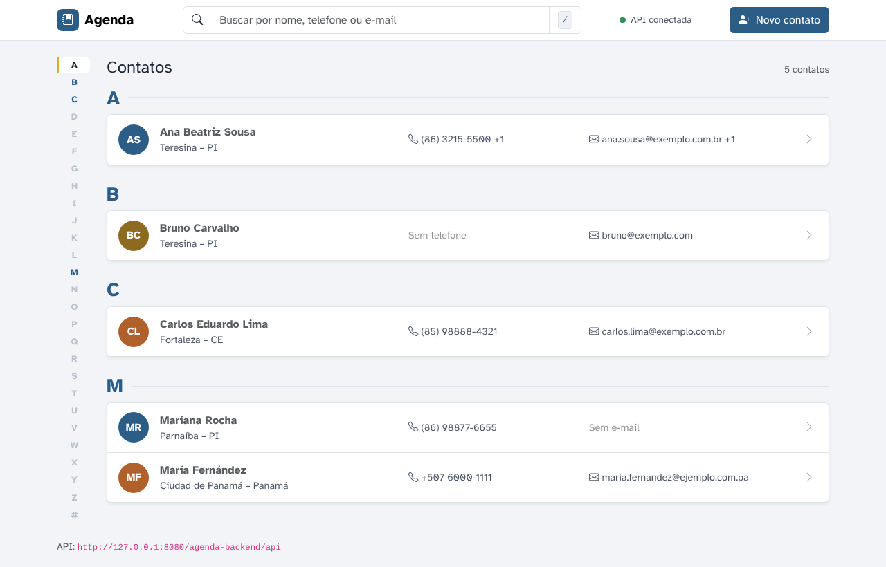
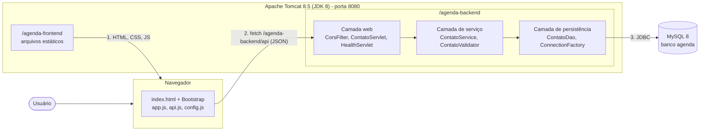
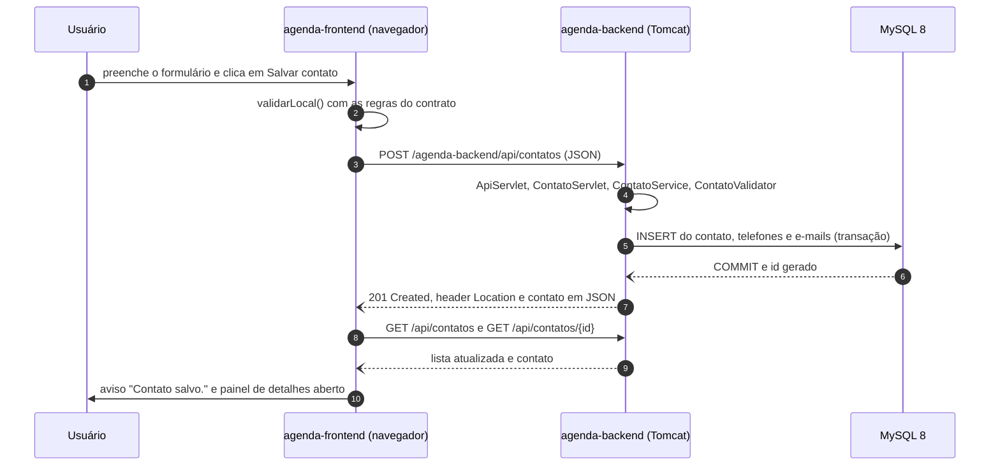
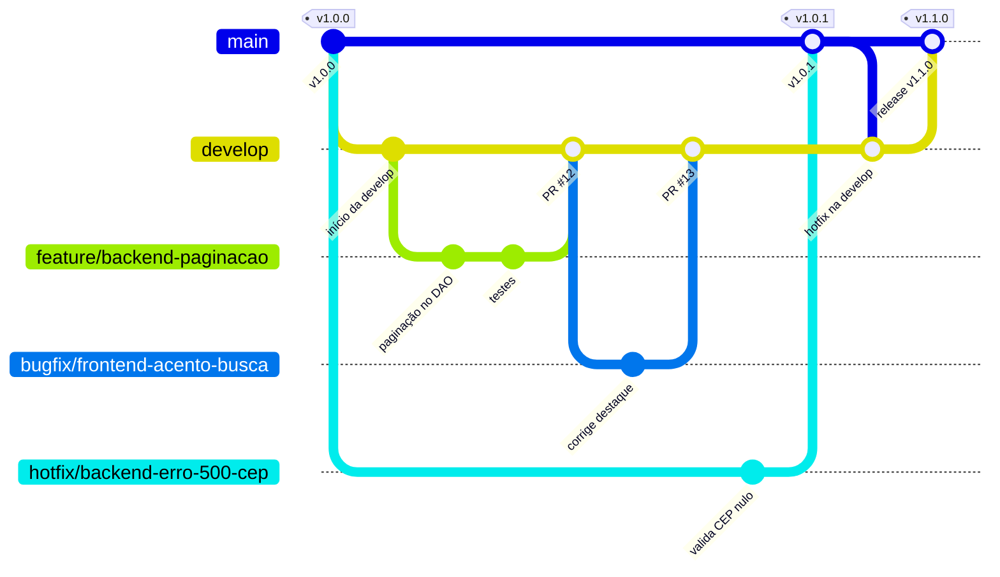
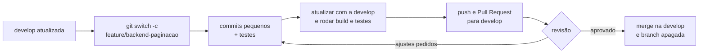

# agenda-contatos-legado

Repositório da **Agenda de Contatos**, uma aplicação web dividida em duas partes que funcionam
juntas:

| Aplicação | Pasta | O que é | Documentação |
|---|---|---|---|
| **agenda-backend** | [`agenda-backend/`](agenda-backend/) | API REST em Java 8 (Servlets + JDBC) que guarda os contatos num MySQL 8 | [README do backend](agenda-backend/README.md) |
| **agenda-frontend** | [`agenda-frontend/`](agenda-frontend/) | Interface web em HTML, CSS, JavaScript e Bootstrap 5 que consome a API | [README do frontend](agenda-frontend/README.md) |

As duas rodam no mesmo **Apache Tomcat 8.5** e são construídas com **Maven 3.3.9** e **JDK 8**.
Este README explica como elas se encaixam, como colocar tudo para rodar e como a equipe deve
trabalhar no repositório. Os detalhes internos de cada aplicação estão no README de cada pasta.



## Sumário

1. [Visão geral](#1-visão-geral)
2. [Estrutura do repositório](#2-estrutura-do-repositório)
3. [Arquitetura integrada](#3-arquitetura-integrada)
4. [Como as duas aplicações funcionam juntas](#4-como-as-duas-aplicações-funcionam-juntas)
5. [Primeiros passos](#5-primeiros-passos)
6. [Testes](#6-testes)
7. [Controle de versão: modelo de branches recomendado](#7-controle-de-versão-modelo-de-branches-recomendado)
8. [Processo de desenvolvimento](#8-processo-de-desenvolvimento)
9. [Convenções da equipe](#9-convenções-da-equipe)
10. [Problemas comuns](#10-problemas-comuns)

---

## 1. Visão geral

A agenda permite listar, buscar, cadastrar, editar e excluir contatos. Cada contato tem nome,
vários telefones, vários e-mails e um endereço.

- O **frontend** é o que o usuário vê: uma página única com índice alfabético, busca, painel de
  detalhes e formulários. Ele não tem acesso ao banco.
- O **backend** é quem guarda e valida os dados: recebe requisições HTTP com JSON, aplica as
  regras de negócio e grava no MySQL.
- Os dois conversam apenas por **HTTP + JSON**, por meio de seis endpoints.

Esse desenho permite corrigir ou evoluir cada parte de forma independente, desde que o
**contrato** entre elas (seção 4.2) seja respeitado.

---

## 2. Estrutura do repositório

```
agenda-contatos-legado/
├── README.md                       este documento (visão integrada)
├── pom.xml                         POM agregador: constrói as duas aplicações de uma vez
├── .gitignore                      ignora target/, arquivos do Eclipse, logs etc.
├── .gitattributes                  fim de linha LF e arquivos binários
├── .github/
│   └── pull_request_template.md    checklist preenchido em todo Pull Request
│
├── agenda-backend/                 API REST (Java 8, Servlets, JDBC, MySQL 8)
│   ├── README.md                   documentação completa do backend
│   ├── pom.xml                     gera agenda-backend.war
│   ├── database/schema.sql         cria banco, usuário, tabelas e dados de exemplo
│   └── src/
│       ├── main/java/br/ufpi/agenda/{model,dao,service,web}/
│       ├── main/resources/db.properties
│       ├── main/webapp/WEB-INF/web.xml
│       └── test/java/.../ContatoValidatorTest.java
│
└── agenda-frontend/                interface web (HTML, CSS, JS, Bootstrap 5)
    ├── README.md                   documentação completa do frontend
    ├── pom.xml                     gera agenda-frontend.war
    ├── docs/                       capturas de tela
    ├── tests/teste_e2e.py          teste ponta a ponta (Playwright)
    └── src/main/webapp/
        ├── index.html
        ├── css/app.css
        ├── js/{config,api,app}.js
        └── vendor/                 Bootstrap, Bootstrap Icons e fonte (locais)
```

As duas pastas são projetos Maven independentes. O `pom.xml` da raiz apenas agrega os dois
(`<modules>`), sem herança: cada aplicação continua podendo ser construída sozinha dentro da
própria pasta.

---

## 3. Arquitetura integrada



1. O Tomcat entrega os arquivos do frontend ao navegador.
2. O JavaScript do frontend chama a API do backend no mesmo Tomcat. Como página e API estão na
   mesma origem (`http://localhost:8080`), não há bloqueio de CORS.
3. O backend valida, executa o SQL e responde em JSON. O frontend redesenha a tela.

### 3.1 Stack completa

| Camada | agenda-frontend | agenda-backend |
|---|---|---|
| Linguagem | HTML5, CSS3, JavaScript ES2017 | Java 8 (bytecode 52) |
| Bibliotecas | Bootstrap 5.3.8, Bootstrap Icons 1.13.1 (locais) | Servlet API 3.1, Gson 2.11.0, MySQL Connector/J 8.4.0 |
| Servidor | Tomcat 8.5, contexto `/agenda-frontend` | Tomcat 8.5, contexto `/agenda-backend` |
| Dados | nenhum (usa a API) | MySQL 8, banco `agenda` |
| Build | Maven 3.3.9 (empacota WAR, sem compilação) | Maven 3.3.9 (compila, testa e empacota WAR) |
| Testes | Playwright (ponta a ponta) + roteiro manual | JUnit 5 (unitários) + roteiro de integração com `curl` |
| IDE | Eclipse IDE for Enterprise Java and Web Developers (2026) | idem |

---

## 4. Como as duas aplicações funcionam juntas

### 4.1 Quem chama o quê

| Ação na interface | Função no frontend | Endpoint no backend | Componente que responde |
|---|---|---|---|
| Abrir a página | `carregar()` | `GET /api/contatos` | `ContatoServlet.doGet` → `ContatoDao.listar` |
| Indicador de status (a cada 30 s) | `verificarApi()` | `GET /api/health` | `HealthServlet` |
| Digitar na busca | `carregar()` após 300 ms | `GET /api/contatos?q=texto` | `ContatoDao.listar(filtro)` |
| Clicar num contato | `abrirDetalhes(id)` | `GET /api/contatos/{id}` | `ContatoDao.buscarPorId` |
| Salvar novo contato | `AgendaApi.criar()` | `POST /api/contatos` | `ContatoService.criar` → `ContatoValidator` → `ContatoDao.inserir` |
| Salvar edição | `AgendaApi.atualizar()` | `PUT /api/contatos/{id}` | `ContatoService.atualizar` → `ContatoDao.atualizar` |
| Confirmar exclusão | `AgendaApi.excluir()` | `DELETE /api/contatos/{id}` | `ContatoDao.excluir` |

### 4.2 O contrato entre as aplicações

Qualquer mudança nestes três pontos afeta as **duas** aplicações e deve ser feita nas duas, no
mesmo Pull Request:

1. **Rotas e métodos HTTP** da tabela acima.
2. **Formato do JSON.** Contato:

   ```json
   {
     "id": 1,
     "nome": "Ana Souza",
     "telefones": ["(86) 99999-0000"],
     "emails": ["ana@ufpi.edu.br"],
     "endereco": { "rua": null, "cep": "64049-550", "cidade": "Teresina", "estado": "PI", "pais": "Brasil" }
   }
   ```

   Erro: `{"erro": "mensagem", "status": 400, "detalhes": ["..."]}`.
3. **Regras de validação**, implementadas no `ContatoValidator` (backend) e repetidas em
   `validarLocal()` (frontend):

   | Campo | Regra |
   |---|---|
   | `nome` | obrigatório, até 120 caracteres |
   | `telefones[]` | 6 a 30 caracteres entre dígitos, espaço e `+ ( ) - .` |
   | `emails[]` | até 150 caracteres, formato `algo@algo.algo` |
   | endereço | rua 200, CEP 20, cidade 100, estado 60, país 60 |

### 4.3 Fluxo de ponta a ponta: cadastro de um contato



### 4.4 Como os erros atravessam as duas camadas

| Situação | Resposta do backend | O que o frontend mostra |
|---|---|---|
| Dados inválidos | 400 com `detalhes` | Lista de erros dentro do formulário |
| Contato inexistente | 404 | Aviso amarelo e lista recarregada |
| Falha de banco numa operação | 500 com mensagem genérica | Mensagem de erro; detalhes só no log do Tomcat |
| Banco fora do ar | `/api/health` 503 | Indicador “Banco indisponível” |
| Backend fora do ar | sem resposta | Indicador “API indisponível” e alerta com **tente de novo** |

---

## 5. Primeiros passos

### 5.1 Pré-requisitos

| Item | Versão | Ubuntu |
|---|---|---|
| Git | qualquer recente | `sudo apt install git` |
| JDK | 8 | `sudo apt install openjdk-8-jdk` |
| Maven | 3.3.9 ou superior | `sudo apt install maven` ou instalação manual |
| MySQL | 8.x | `sudo apt install mysql-server` |
| Apache Tomcat | 8.5.100 | descompactar de `https://archive.apache.org/dist/tomcat/tomcat-8/v8.5.100/bin/` |
| Eclipse (opcional) | IDE for Enterprise Java and Web Developers (2026) | site do Eclipse |
| Python 3 + Playwright (opcional) | para o teste E2E do frontend | `pip install --user --break-system-packages playwright` |

### 5.2 Clonar o repositório

```bash
git clone https://github.com/armandossrecife/agenda-contatos-legado.git
cd agenda-contatos-legado
git switch develop        # o trabalho do dia a dia parte da develop (seção 7)
```

### 5.3 Criar o banco

```bash
sudo systemctl start mysql
sudo mysql < agenda-backend/database/schema.sql
```

O script cria o banco `agenda`, o usuário `agenda`/`agenda` e três contatos de exemplo. Rodá-lo
de novo restaura os dados de exemplo.

### 5.4 Construir as duas aplicações

Na raiz do repositório, com o Maven rodando sobre o JDK 8:

```bash
JAVA_HOME=/usr/lib/jvm/java-8-openjdk-amd64 mvn clean package
```

```
[INFO] Reactor Summary:
[INFO] agenda-backend ...... SUCCESS     (inclui os 5 testes JUnit)
[INFO] agenda-frontend ..... SUCCESS
[INFO] Agenda de Contatos (legado) - backend e frontend ... SUCCESS
[INFO] BUILD SUCCESS
```

Resultado: `agenda-backend/target/agenda-backend.war` e `agenda-frontend/target/agenda-frontend.war`.

### 5.5 Implantar

**Opção A: Tomcat standalone**

```bash
sudo cp agenda-backend/target/agenda-backend.war   /opt/apache-tomcat-8.5.100/webapps/
sudo cp agenda-frontend/target/agenda-frontend.war /opt/apache-tomcat-8.5.100/webapps/
sudo env JAVA_HOME=/usr/lib/jvm/java-8-openjdk-amd64 /opt/apache-tomcat-8.5.100/bin/startup.sh
```

**Opção B: Eclipse**

1. *File > Import… > Maven > Existing Maven Projects*, selecione a pasta raiz do repositório.
   O Eclipse lista três projetos: o agregador, o `agenda-backend` e o `agenda-frontend`. Importe
   os três.
2. Associe *JavaSE-1.8* ao JDK 8 (*Preferences > Java > Installed JREs > Execution Environments*)
   e cadastre o Tomcat 8.5 com o JDK 8 (*Preferences > Server > Runtime Environments*).
3. Compile o backend com *Run As > Maven build…*, goals `package`, JRE `java-8-openjdk-amd64`,
   e pressione `F5`.
4. Na aba *Servers*, use *Add and Remove…* para adicionar **as duas** aplicações ao Tomcat v8.5
   e inicie o servidor.

### 5.6 Verificar

| Verificação | Endereço | Esperado |
|---|---|---|
| Backend e banco | http://localhost:8080/agenda-backend/api/health | `"status": "UP"` |
| API | http://localhost:8080/agenda-backend/api/contatos | 3 contatos em JSON |
| Frontend | http://localhost:8080/agenda-frontend/ | Lista agrupada por letra e indicador “API conectada” |

---

## 6. Testes

| Aplicação | Teste | Comando | Quando rodar |
|---|---|---|---|
| backend | 5 testes unitários do `ContatoValidator` (JUnit 5) | `mvn test` na raiz ou em `agenda-backend/` | Sempre; o `mvn package` já roda |
| backend | 12 passos de integração da API com `curl` | ver [README do backend, seção 9.4](agenda-backend/README.md#94-testes-de-integração-da-api) | Mudanças no backend |
| frontend | Teste ponta a ponta (8 passos, Playwright) | `python3 agenda-frontend/tests/teste_e2e.py` | Mudanças no frontend ou no contrato |
| frontend | Roteiro manual de 18 casos | ver [README do frontend, seção 9.4](agenda-frontend/README.md#94-roteiro-de-testes-manuais) | Antes de um release |

O teste ponta a ponta do frontend é também o teste de integração entre as duas aplicações: ele
só passa se o backend, o banco e o frontend estiverem funcionando juntos.

Ordem recomendada antes de abrir um Pull Request:

```bash
JAVA_HOME=/usr/lib/jvm/java-8-openjdk-amd64 mvn clean package    # build + testes unitários
# implantar os dois WARs no Tomcat (seção 5.5)
curl -s http://localhost:8080/agenda-backend/api/health          # deve responder UP
python3 agenda-frontend/tests/teste_e2e.py                       # fluxo completo pela interface
```

---

## 7. Controle de versão: modelo de branches recomendado

O repositório usa um modelo inspirado no Git Flow, simplificado para uma equipe pequena:

| Branch | Vida | Parte de | Volta para | Para que serve |
|---|---|---|---|---|
| `main` | permanente | - | - | **Código estável.** Cada commit corresponde a uma versão liberada e recebe uma tag (`v1.0.0`, `v1.1.0`...). Ninguém faz commit direto. |
| `develop` | permanente | `main` | `main` (por release) | **Integração.** Reúne as funcionalidades e correções prontas para a próxima versão. Ninguém faz commit direto. |
| `feature/<app>-<descricao>` | temporária | `develop` | `develop` | **Nova funcionalidade.** Ex.: `feature/backend-paginacao`, `feature/frontend-ordenar-por-cidade`. |
| `bugfix/<app>-<descricao>` | temporária | `develop` | `develop` | **Correção** de um defeito encontrado durante o desenvolvimento ou de um defeito que pode esperar a próxima versão. Ex.: `bugfix/frontend-acento-busca`. |
| `hotfix/<app>-<descricao>` | temporária | `main` | `main` **e** `develop` | **Correção urgente** de um defeito na versão em uso, que não pode esperar a próxima versão. Ex.: `hotfix/backend-erro-500-cep`. |

O prefixo `<app>` (`backend`, `frontend` ou `ambos`) deixa claro qual aplicação a branch altera.
Use `ambos` quando a mudança mexer no contrato.

### 7.1 Visão do fluxo



### 7.2 Regras do modelo

1. `main` e `develop` são **protegidas**: só recebem código por **Pull Request** aprovado.
2. Toda branch de trabalho é **curta**: uma funcionalidade ou uma correção por branch, de
   preferência concluída em poucos dias.
3. Antes de abrir o PR, a branch é **atualizada** com a `develop` (ou com a `main`, no caso de
   hotfix), e o build e os testes passam.
4. Depois do merge, a branch temporária é **apagada**.
5. Mudanças no **contrato** (seção 4.2) alteram backend e frontend **no mesmo PR**, para que a
   `develop` nunca fique com as duas aplicações incompatíveis.

### 7.3 Configuração inicial no GitHub (feita uma vez pelo responsável)

1. Criar a `develop` a partir da `main` e enviá-la:

   ```bash
   git switch main
   git switch -c develop
   git push -u origin develop
   ```

2. Em *Settings > Branches > Add branch ruleset* (ou *Add rule*), proteger `main` e `develop`:
   - *Require a pull request before merging*, com pelo menos **1 aprovação**;
   - *Require conversation resolution before merging*;
   - *Block force pushes* e impedir a exclusão da branch.
3. Em *Settings > General*, marcar *Automatically delete head branches* para apagar as branches
   depois do merge.
4. Em *Settings > Collaborators*, convidar os desenvolvedores com permissão **Write**.
5. Opcional: definir `develop` como branch padrão em *Settings > General > Default branch*, para
   que os PRs já abram apontando para ela.

---

## 8. Processo de desenvolvimento

### 8.1 Nova funcionalidade (`feature/*`)

Exemplo: adicionar paginação à listagem de contatos no backend.



Passo a passo:

```bash
# 1. Partir da develop atualizada
git switch develop
git pull origin develop

# 2. Criar a branch da funcionalidade
git switch -c feature/backend-paginacao

# 3. Desenvolver em commits pequenos e descritivos
git add agenda-backend/src/main/java/br/ufpi/agenda/dao/ContatoDao.java
git commit -m "feat(backend): adiciona LIMIT e OFFSET na listagem de contatos"
git add agenda-backend/src/test/java
git commit -m "test(backend): cobre parâmetros de paginação inválidos"

# 4. Trazer o que entrou na develop enquanto você trabalhava
git fetch origin
git merge origin/develop          # resolva conflitos, se houver

# 5. Validar
JAVA_HOME=/usr/lib/jvm/java-8-openjdk-amd64 mvn clean package
python3 agenda-frontend/tests/teste_e2e.py     # com os WARs implantados

# 6. Enviar e abrir o Pull Request para a develop
git push -u origin feature/backend-paginacao
```

No GitHub, clique em **Compare & pull request**, escolha **base: develop**, preencha o template
(aplicação afetada, como testou, se altera o contrato) e peça revisão. Depois da aprovação, faça
o merge pelo GitHub. Por fim, atualize sua cópia local:

```bash
git switch develop
git pull origin develop
git branch -d feature/backend-paginacao
```

### 8.2 Correção (`bugfix/*`)

Exemplo: o destaque da busca no frontend não funciona em nomes com acento.

```bash
# 1. Registrar o defeito como issue no GitHub (ex.: #27), com passos para reproduzir

# 2. Partir da develop atualizada
git switch develop
git pull origin develop
git switch -c bugfix/frontend-acento-busca

# 3. Reproduzir, corrigir e, se possível, criar um teste que falhava antes da correção
git add agenda-frontend/src/main/webapp/js/app.js
git commit -m "fix(frontend): corrige destaque da busca em nomes acentuados (#27)"

# 4. Atualizar, validar e enviar
git fetch origin && git merge origin/develop
JAVA_HOME=/usr/lib/jvm/java-8-openjdk-amd64 mvn clean package
python3 agenda-frontend/tests/teste_e2e.py
git push -u origin bugfix/frontend-acento-busca
```

Abra o PR para a **develop** com `Fecha #27` na descrição: o GitHub fecha a issue
automaticamente quando o PR é aceito.

### 8.3 Correção urgente na versão em uso (`hotfix/*`)

Use apenas quando o defeito está na versão liberada (`main`) e não pode esperar o próximo
release. Exemplo: erro 500 ao salvar contato com CEP vazio.

```bash
# 1. Partir da main
git switch main
git pull origin main
git switch -c hotfix/backend-erro-500-cep

# 2. Corrigir e ajustar a versão de correção no pom.xml do backend (ex.: 2.1.0 -> 2.1.1)
git commit -am "fix(backend): trata CEP vazio ao salvar contato"

# 3. Validar e abrir o PR para a main
JAVA_HOME=/usr/lib/jvm/java-8-openjdk-amd64 mvn clean package
git push -u origin hotfix/backend-erro-500-cep
```

Depois do merge na `main`:

```bash
# 4. Marcar a versão de correção
git switch main && git pull origin main
git tag -a v1.0.1 -m "v1.0.1: correção do erro 500 com CEP vazio"
git push origin v1.0.1

# 5. Levar a correção para a develop (via PR main -> develop, ou localmente):
git switch develop && git pull origin develop
git merge main
git push origin develop
```

### 8.4 Liberação de versão (release)

Quando a `develop` reúne o que deve ir para a próxima versão:

1. Atualize as versões nos `pom.xml` das aplicações alteradas (por exemplo, backend `2.2.0`) e o
   `CHANGELOG`, se a equipe mantiver um.
2. Rode o build, os testes unitários, o teste ponta a ponta e o roteiro manual.
3. Abra um PR **develop → main** com o título `Release v1.1.0` e a lista das mudanças.
4. Após o merge, crie a tag e a release:

   ```bash
   git switch main && git pull origin main
   git tag -a v1.1.0 -m "v1.1.0: paginação no backend e correções no frontend"
   git push origin v1.1.0
   ```

5. Em *Releases > Draft a new release*, escolha a tag e anexe os dois WARs gerados.

### 8.5 Resumo: de onde parte e para onde volta

| Situação | Parte de | Nome da branch | PR para | Após o merge |
|---|---|---|---|---|
| Nova funcionalidade | `develop` | `feature/<app>-<descricao>` | `develop` | apagar a branch |
| Defeito que pode esperar | `develop` | `bugfix/<app>-<descricao>` | `develop` | apagar a branch |
| Defeito urgente em produção | `main` | `hotfix/<app>-<descricao>` | `main` | tag `vX.Y.Z+1` e merge na `develop` |
| Liberar versão | `develop` | - | `main` | tag `vX.Y.0` e release no GitHub |

---

## 9. Convenções da equipe

### 9.1 Mensagens de commit

Formato baseado em *Conventional Commits*, com a aplicação no escopo:

```
<tipo>(<escopo>): <descrição no imperativo, em minúsculas>
```

| Tipo | Uso | Exemplo |
|---|---|---|
| `feat` | nova funcionalidade | `feat(frontend): adiciona ordenação por cidade` |
| `fix` | correção | `fix(backend): devolve 404 ao atualizar id inexistente` |
| `test` | testes | `test(backend): cobre e-mail com espaços` |
| `docs` | documentação | `docs(ambos): atualiza contrato da API no README` |
| `refactor` | refatoração sem mudança de comportamento | `refactor(backend): extrai SQL de listagem` |
| `build` | Maven, dependências | `build(backend): atualiza gson para 2.11.0` |
| `chore` | tarefas gerais | `chore: ajusta .gitignore` |

Escopos: `backend`, `frontend`, `ambos` ou nenhum (mudanças na raiz).

### 9.2 Versionamento

- **Tags do repositório** seguem o *Versionamento Semântico* (`vMAIOR.MENOR.CORREÇÃO`) e marcam
  cada liberação na `main`.
- **Cada aplicação** mantém sua própria versão no `pom.xml` (hoje: backend `2.1.0`, frontend
  `1.0.0`), atualizada só quando a aplicação muda.
- Mudança incompatível no contrato da API incrementa a versão **maior** do backend.

### 9.3 Revisão de código

O revisor confere, além da lógica:

- se o build e os testes passam;
- se a mudança respeita as restrições do ambiente: **Java 8** (nada de `var`, `List.of`, text
  blocks), **`javax.servlet`** (Tomcat 8.5) e **Maven 3.3.9**;
- se dados da API continuam entrando no frontend por `textContent`, nunca por `innerHTML`;
- se o README da aplicação foi atualizado quando a mudança afeta uso, endpoints ou instalação.

### 9.4 O que nunca vai para o repositório

- Pastas `target/` e arquivos gerados pelo Eclipse (`.settings`, `.classpath`, `.project`): o
  `.gitignore` já cuida disso. Cada desenvolvedor gera os seus ao importar o projeto.
- Senhas reais de banco. O `db.properties` versionado usa o usuário de desenvolvimento
  `agenda`/`agenda`; ambientes reais usam as variáveis `DB_URL`, `DB_USER` e `DB_PASSWORD`
  (README do backend, seção 8.6).
- WARs gerados: eles são anexados às *Releases* do GitHub, não versionados.

---

## 10. Problemas comuns

| Sintoma | Causa provável e solução |
|---|---|
| Frontend mostra “API indisponível” | O `agenda-backend` não está implantado ou falhou ao iniciar. Teste `/agenda-backend/api/health` e veja o log do Tomcat. |
| `ClassNotFoundException` ao iniciar o backend | Classes não compiladas ou não publicadas. Rode `mvn package`, `F5` e *Servers > Clean…* (README do backend, seção 8.8). |
| Maven falha com erro de versão | Maven 3.3.9 rodando sobre JDK 9+. Use `JAVA_HOME=/usr/lib/jvm/java-8-openjdk-amd64`. |
| Eclipse mostra três projetos ao importar | Esperado: o agregador da raiz e as duas aplicações. |
| Conflito de merge no `pom.xml` de uma aplicação | Normalmente nas versões: mantenha a maior e confirme com a equipe. |
| `git push` recusado em `main` ou `develop` | As branches são protegidas. Crie uma branch `feature/*`, `bugfix/*` ou `hotfix/*` e abra um PR. |
| Arquivos do Eclipse aparecem no `git status` | Foram adicionados antes do `.gitignore`. Remova do índice com `git rm -r --cached .settings .classpath .project` dentro da aplicação. |

Para problemas específicos de cada aplicação, consulte as seções de problemas comuns do
[README do backend](agenda-backend/README.md) e do [README do frontend](agenda-frontend/README.md).
