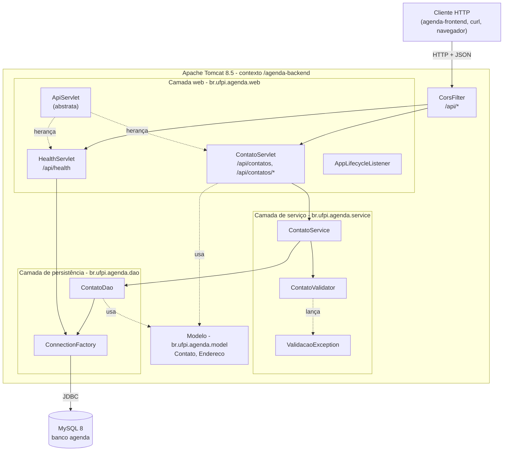
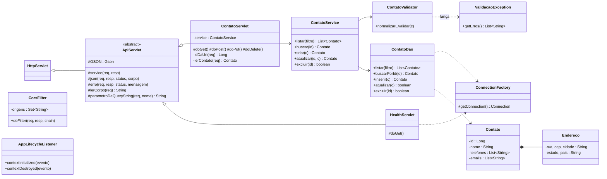
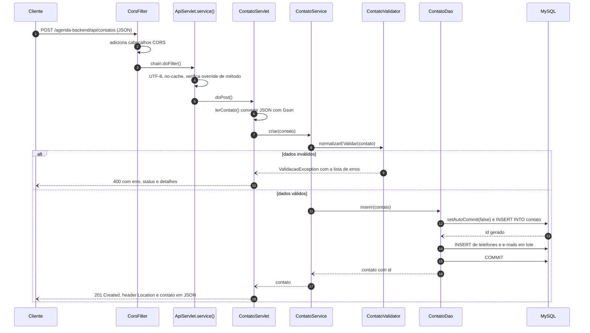
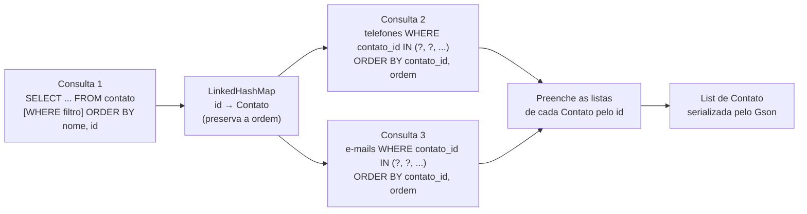
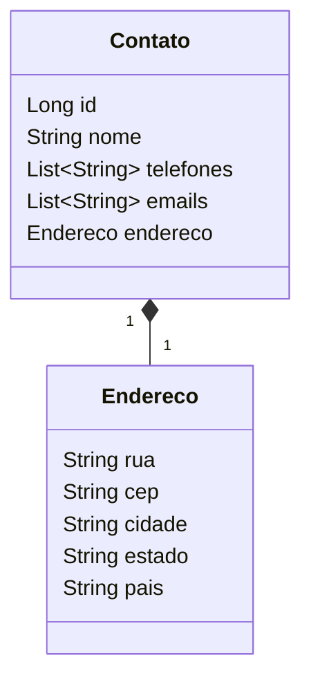
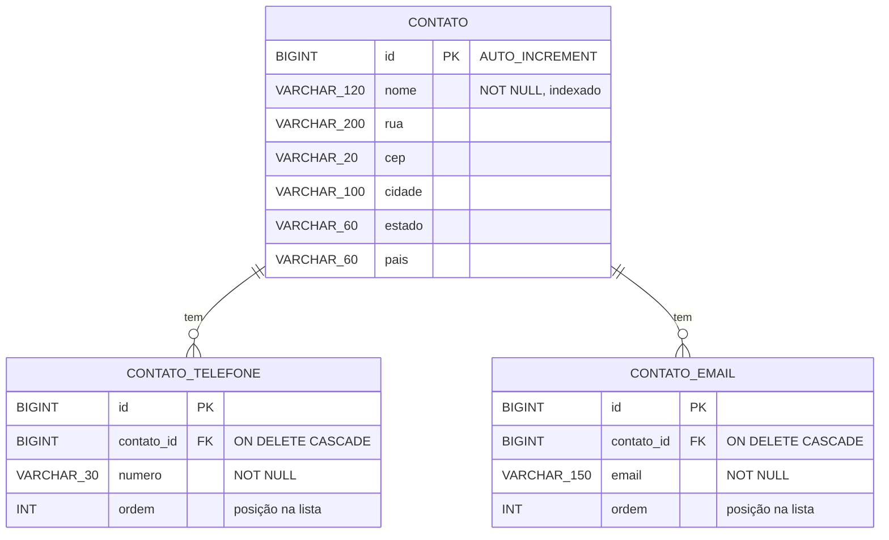

# Agenda de Contatos: backend REST

API REST de uma agenda de contatos, escrita em **Java 8** com Servlets e JDBC, sem
frameworks. Roda no **Apache Tomcat 8.5**, guarda os dados num **MySQL 8** e é construída
com **Maven**. É consumida pelo projeto **agenda-frontend** (HTML, CSS, JavaScript e
Bootstrap), mas pode ser usada por qualquer cliente HTTP.

## Sumário

1. [Visão geral](#1-visão-geral)
2. [Stack de tecnologias](#2-stack-de-tecnologias)
3. [Estrutura de arquivos](#3-estrutura-de-arquivos)
4. [Arquitetura e componentes](#4-arquitetura-e-componentes)
5. [Fluxo de requisição](#5-fluxo-de-requisição)
6. [Modelo de dados e banco](#6-modelo-de-dados-e-banco)
7. [Endpoints da API](#7-endpoints-da-api)
8. [Build e implantação](#8-build-e-implantação)
9. [Testes](#9-testes)
10. [Limitações conhecidas](#10-limitações-conhecidas)

---

## 1. Visão geral

A aplicação gerencia contatos. Cada contato tem um nome, uma lista de telefones, uma lista
de e-mails e um endereço. A API oferece as operações de CRUD sobre esses contatos e uma rota
de verificação de saúde:

| Operação | Método e rota |
|---|---|
| Listar (com busca opcional) | `GET /api/contatos?q=texto` |
| Buscar por id | `GET /api/contatos/{id}` |
| Criar | `POST /api/contatos` |
| Atualizar | `PUT /api/contatos/{id}` |
| Excluir | `DELETE /api/contatos/{id}` |
| Saúde da aplicação e do banco | `GET /api/health` |

Características principais:

- **Arquitetura em camadas** (web, serviço, persistência e modelo), cada uma num pacote Java.
- **JSON** em todas as respostas, inclusive nos erros, com um formato único:
  `{"erro": "...", "status": 400, "detalhes": [...]}`.
- **Validação e normalização** dos dados antes de gravar (espaços, duplicatas, formatos).
- **Transações** nas gravações: o contato e suas listas são salvos juntos ou nada é salvo.
- **Consultas sem o problema N+1**: a listagem usa sempre três consultas, qualquer que seja o
  número de contatos.
- **CORS liberado** para um frontend servido em outra origem.
- **Compatibilidade com clientes limitados**: override de método HTTP e supressão de
  códigos de status (seção 7.8).

---

## 2. Stack de tecnologias

| Camada | Tecnologia | Versão | Observação |
|---|---|---|---|
| Linguagem | Java | 8 (bytecode 52) | Código sem recursos de Java 9+ (`var`, `List.of`, text blocks etc.) |
| Servidor | Apache Tomcat | 8.5.100 | Servlet 3.1, pacote `javax.servlet` |
| API web | Java Servlet API | 3.1.0 | Escopo `provided`: fornecida pelo Tomcat |
| JSON | Google Gson | 2.11.0 | Serialização e desserialização dos contatos |
| Banco de dados | MySQL | 8.x | Também funciona com 5.7 e 9.x |
| Driver JDBC | MySQL Connector/J (`mysql-connector-j`) | 8.4.0 | Classe `com.mysql.cj.jdbc.Driver` |
| Testes | JUnit Jupiter (JUnit 5) | 5.8.2 | Executado pelo Surefire 2.22.2 |
| Build | Apache Maven | 3.3.9 ou superior | Todos os plugins exigem no máximo Maven 3.1 |
| IDE (opcional) | Eclipse IDE for Enterprise Java and Web Developers | 2026 | Importado como projeto Maven |

Plugins Maven fixados no `pom.xml` (para que o Maven 3.3.9 não use versões antigas que não
suportam JUnit 5):

| Plugin | Versão | Função |
|---|---|---|
| `maven-clean-plugin` | 3.1.0 | Apaga a pasta `target/` |
| `maven-resources-plugin` | 3.2.0 | Copia `db.properties` para o classpath, em UTF-8 |
| `maven-compiler-plugin` | 3.8.1 | Compila com `source`/`target` 1.8 |
| `maven-surefire-plugin` | 2.22.2 | Executa os testes JUnit 5 |
| `maven-war-plugin` | 3.3.2 | Gera o `agenda-backend.war` |
| `maven-install-plugin` | 2.5.2 | Instala o WAR no repositório local (`mvn install`) |

O `pom.xml` exclui a dependência transitiva `protobuf-java` do driver MySQL. Ela só é usada
pela X DevAPI (porta 33060), não pelo JDBC, e sua exclusão reduz o WAR em cerca de 1,7 MB.

---

## 3. Estrutura de arquivos

```
agenda-backend/
├── pom.xml                                   build Maven (packaging war)
├── README.md                                 este documento
├── .gitignore                                ignora target/ e arquivos do Eclipse
├── database/
│   └── schema.sql                            cria banco, usuário, tabelas e dados de exemplo
└── src/
    ├── main/
    │   ├── java/br/ufpi/agenda/
    │   │   ├── model/
    │   │   │   ├── Contato.java              entidade: id, nome, telefones, e-mails, endereço
    │   │   │   └── Endereco.java             rua, CEP, cidade, estado, país
    │   │   ├── dao/
    │   │   │   ├── ConnectionFactory.java    abre conexões JDBC a partir da configuração
    │   │   │   └── ContatoDao.java           SQL de listagem, busca, inserção, atualização e exclusão
    │   │   ├── service/
    │   │   │   ├── ContatoService.java       regras de negócio; valida e chama o DAO
    │   │   │   ├── ContatoValidator.java     normalização e validação dos dados
    │   │   │   └── ValidacaoException.java   exceção com a lista de erros de validação
    │   │   └── web/
    │   │       ├── ApiServlet.java           base dos servlets: UTF-8, JSON, erros, override de método
    │   │       ├── ContatoServlet.java       endpoints /api/contatos
    │   │       ├── HealthServlet.java        endpoint /api/health
    │   │       ├── CorsFilter.java           cabeçalhos CORS e respostas de preflight
    │   │       └── AppLifecycleListener.java libera o driver MySQL ao parar a aplicação
    │   ├── resources/
    │   │   └── db.properties                 URL, usuário e senha do banco
    │   └── webapp/
    │       ├── index.html                    página com links para testar a API
    │       └── WEB-INF/
    │           └── web.xml                   registro de servlets, filtro e listener
    └── test/java/br/ufpi/agenda/service/
        └── ContatoValidatorTest.java         5 testes unitários do validador
```

Contagem de código: 10 classes de produção, distribuídas em 4 pacotes, e 1 classe de teste.

O que o Maven gera em `target/` (não versionado):

| Caminho | Conteúdo |
|---|---|
| `target/classes/` | Classes compiladas e o `db.properties` |
| `target/test-classes/` | Classe de teste compilada |
| `target/surefire-reports/` | Resultado dos testes em texto e XML |
| `target/agenda-backend.war` | Pacote para implantação no Tomcat |

Conteúdo do WAR gerado:

```
agenda-backend.war
├── index.html
├── META-INF/MANIFEST.MF
└── WEB-INF/
    ├── web.xml
    ├── classes/                       as 10 classes + db.properties
    └── lib/
        ├── gson-2.11.0.jar
        ├── error_prone_annotations-2.27.0.jar   (dependência do Gson)
        └── mysql-connector-j-8.4.0.jar
```

---

## 4. Arquitetura e componentes

### 4.1 Visão em camadas



Regras da arquitetura:

- Cada camada só chama a camada imediatamente abaixo. O servlet não executa SQL, e o DAO não
  conhece HTTP.
- O modelo (`Contato`, `Endereco`) é compartilhado por todas as camadas e é o mesmo objeto que
  o Gson converte de e para JSON.
- O `HealthServlet` é a única exceção: usa a `ConnectionFactory` diretamente, porque seu
  papel é justamente testar a conexão.

### 4.2 Diagrama de classes



### 4.3 Responsabilidade de cada componente

| Componente | Responsabilidade |
|---|---|
| `ApiServlet` | Base de todos os endpoints. Define UTF-8 e desliga o cache. Despacha para `doGet`, `doPost`, `doPut` ou `doDelete`, considerando o override de método. Serializa respostas com Gson (`serializeNulls`) e monta o JSON de erro padronizado. |
| `ContatoServlet` | Traduz HTTP em chamadas ao serviço: extrai o id da URL, converte o corpo JSON em `Contato` e converte exceções em códigos HTTP (400, 404, 405, 500). |
| `HealthServlet` | Informa a versão do Java, do servidor e do banco. Responde 200 (`UP`) ou 503 (`DOWN`). |
| `CorsFilter` | Adiciona `Access-Control-Allow-Origin` e expõe o header `Location`. Responde ao preflight (`OPTIONS`) com 204. As origens permitidas vêm do `web.xml`. |
| `AppLifecycleListener` | Registra no log o início da aplicação. Ao parar ou republicar, remove o driver do `DriverManager` e encerra a thread de limpeza do Connector/J, evitando vazamento de memória. |
| `ContatoService` | Valida antes de gravar. Na criação, ignora qualquer id enviado no corpo; na atualização, usa o id da URL. Recebe DAO e validador pelo construtor, o que permite testes com dublês. |
| `ContatoValidator` | Normaliza (remove espaços, itens vazios e duplicados) e valida formatos e tamanhos, acumulando todos os erros antes de lançar a exceção. Não depende de banco. |
| `ValidacaoException` | Exceção verificada com a lista de erros. Vira HTTP 400 com o campo `detalhes`. |
| `ContatoDao` | Todo o SQL da aplicação, com `PreparedStatement`, transações manuais e carga das listas em lote. |
| `ConnectionFactory` | Lê a configuração do banco e abre conexões via `DriverManager`. |
| `Contato` / `Endereco` | POJOs serializáveis. Os setters de `Contato` trocam `null` por lista vazia ou endereço vazio, então o resto do código nunca recebe nulo nesses campos. |

### 4.4 Configuração da aplicação web (`web.xml`)

Os componentes são registrados no `web.xml`, e não por anotações:

| Tipo | Classe | Mapeamento |
|---|---|---|
| Listener | `AppLifecycleListener` | Ciclo de vida da aplicação |
| Filtro | `CorsFilter` (`allowedOrigins = *`) | `/api/*` |
| Servlet | `ContatoServlet` | `/api/contatos` e `/api/contatos/*` |
| Servlet | `HealthServlet` | `/api/health` |
| Página inicial | `index.html` | `/` |

O atributo `metadata-complete="true"` faz o Tomcat ignorar anotações como `@WebServlet` e não
varrer as classes e JARs atrás delas. Isso deixa explícito tudo o que a aplicação registra e
acelera a inicialização.

---

## 5. Fluxo de requisição

### 5.1 Criação de um contato (`POST /api/contatos`)



Passo a passo:

1. **Filtro.** O `CorsFilter` adiciona os cabeçalhos CORS. Se fosse um preflight (`OPTIONS`
   com `Access-Control-Request-Method`), responderia 204 e pararia ali.
2. **Entrada comum.** `ApiServlet.service()` configura UTF-8 e cache. Num `POST`, procura o
   header `X-HTTP-Method-Override` ou o parâmetro `?_method=`; sem eles, chama `doPost()`.
3. **Conversão.** `ContatoServlet` lê o corpo. Corpo vazio gera 400 “Corpo JSON obrigatório”,
   e JSON malformado gera 400 “JSON inválido”.
4. **Regras.** `ContatoService.criar()` chama o validador, que limpa os dados e lança
   `ValidacaoException` se houver qualquer erro. Em seguida, define `id = null`.
5. **Gravação.** `ContatoDao.inserir()` abre uma conexão, desliga o autocommit, insere o
   contato, recupera o id gerado e grava as listas com `addBatch()`. Qualquer falha executa
   `rollback()`, e nada fica gravado pela metade.
6. **Resposta.** O servlet devolve 201 com o header `Location` e o contato completo em JSON.

### 5.2 Listagem sem o problema N+1 (`GET /api/contatos`)

Uma implementação ingênua faria uma consulta de telefones e outra de e-mails para cada
contato: com 100 contatos, seriam 201 consultas. O DAO faz sempre três:



### 5.3 Como as exceções viram respostas HTTP

| Situação | Onde é detectada | Resposta |
|---|---|---|
| Id não numérico na URL (`/api/contatos/abc`) | `ContatoServlet.idDaUrl()` | 400 `Id inválido: abc` |
| Corpo vazio ou JSON malformado | `ContatoServlet.lerContato()` | 400 |
| Dados inválidos | `ContatoValidator` | 400 com `detalhes` |
| `POST` com id na URL | `ContatoServlet.doPost()` | 405 |
| `PUT` ou `DELETE` sem id | `ContatoServlet` | 400 `Informe o id na URL: /api/contatos/{id}` |
| Método não suportado (por exemplo `PATCH`) | `ApiServlet.service()` | 405 |
| Id inexistente | `ContatoService` / `ContatoDao` | 404 `Contato {id} não encontrado` |
| Falha de banco (`SQLException`) | `ContatoServlet.falhaBanco()` | 500 com mensagem genérica; detalhes completos só no log do Tomcat |

Na resposta 500, a mensagem da `SQLException` não é enviada ao cliente, para não expor nomes
de tabelas ou do servidor de banco. O erro completo fica registrado no log do Tomcat.

---

## 6. Modelo de dados e banco

### 6.1 Modelo de objetos (Java)



Representação em JSON, que é a mesma usada na entrada e na saída da API:

```json
{
  "id": 1,
  "nome": "Ana Souza",
  "telefones": ["(86) 99999-0000", "(86) 3215-5500"],
  "emails": ["ana@ufpi.edu.br"],
  "endereco": {
    "rua": "Av. Universitária, 1310",
    "cep": "64049-550",
    "cidade": "Teresina",
    "estado": "PI",
    "pais": "Brasil"
  }
}
```

O Gson está configurado com `serializeNulls()`, então campos sem valor aparecem como `null`
na resposta, em vez de serem omitidos. Isso dá ao cliente uma estrutura sempre previsível.

### 6.2 Modelo relacional (MySQL)



Decisões de modelagem:

- **Endereço nas colunas de `contato`.** A relação é 1:1 e o endereço não existe sem o contato,
  então não precisa de tabela própria.
- **Telefones e e-mails em tabelas filhas (1:N).** Um contato pode ter quantos quiser.
- **Coluna `ordem`.** Guarda a posição de cada item, para que as listas voltem na mesma
  sequência em que foram enviadas.
- **`ON DELETE CASCADE`.** Excluir um contato remove automaticamente seus telefones e e-mails.
- **Índices** em `contato(nome)`, usado na ordenação e na busca, e em `(contato_id, ordem)`
  nas tabelas filhas, usados na carga das listas.
- **`utf8mb4` com `utf8mb4_unicode_ci`.** Aceita qualquer caractere Unicode, e a ordenação e
  as comparações ignoram acentos e maiúsculas.

### 6.3 Do JSON às tabelas

| Campo JSON | Tabela.coluna |
|---|---|
| `id` | `contato.id` |
| `nome` | `contato.nome` |
| `endereco.rua`, `.cep`, `.cidade`, `.estado`, `.pais` | `contato.rua`, `cep`, `cidade`, `estado`, `pais` |
| `telefones[i]` | `contato_telefone.numero`, com `ordem = i` |
| `emails[i]` | `contato_email.email`, com `ordem = i` |

### 6.4 Regras de validação

Antes de validar, o `ContatoValidator` normaliza os dados:

- remove espaços do início e do fim de todos os textos;
- texto vazio vira `null`;
- itens vazios e duplicados saem das listas, preservando a ordem.

Depois, aplica as regras e acumula todos os erros encontrados:

| Campo | Regra | Mensagem de erro |
|---|---|---|
| `nome` | Obrigatório, até 120 caracteres | `O nome é obrigatório` / `O nome deve ter no máximo 120 caracteres` |
| `telefones[]` | De 6 a 30 caracteres entre dígitos, espaço e `+ ( ) - .` | `Telefone inválido: {valor}` |
| `emails[]` | Até 150 caracteres, formato `algo@algo.algo` | `E-mail inválido: {valor}` |
| `endereco.rua` | Até 200 caracteres | `O campo rua deve ter no máximo 200 caracteres` |
| `endereco.cep` | Até 20 caracteres | `O campo CEP deve ter no máximo 20 caracteres` |
| `endereco.cidade` | Até 100 caracteres | `O campo cidade deve ter no máximo 100 caracteres` |
| `endereco.estado` | Até 60 caracteres | `O campo estado deve ter no máximo 60 caracteres` |
| `endereco.pais` | Até 60 caracteres | `O campo país deve ter no máximo 60 caracteres` |
| corpo inteiro | Não pode ser nulo | `Corpo da requisição vazio ou inválido` |

Os limites de tamanho coincidem com os tamanhos das colunas no banco.

### 6.5 Acesso ao banco

| Operação do DAO | SQL executado | Transação |
|---|---|---|
| `listar(filtro)` | 1 `SELECT` em `contato` (com `LIKE` em nome, e-mail e telefone, se houver filtro) + 2 `SELECT ... IN (...)` para as listas | Não |
| `buscarPorId(id)` | 1 `SELECT` em `contato` + 2 `SELECT` para as listas | Não |
| `inserir(c)` | `INSERT` em `contato` + `INSERT` em lote nas tabelas filhas | Sim |
| `atualizar(c)` | `UPDATE` em `contato` + `DELETE` das listas antigas + `INSERT` em lote das novas | Sim |
| `excluir(id)` | `DELETE` em `contato` (as listas saem por cascata) | Não (uma única instrução) |

Detalhes de implementação:

- Todo o SQL usa `PreparedStatement` com parâmetros `?`, o que impede SQL injection.
- Conexões, statements e result sets são fechados automaticamente por try-with-resources.
- Na atualização, o MySQL devolve 0 linhas afetadas quando nenhum valor muda. Por isso, o DAO
  confirma com um `SELECT 1` se o id existe antes de responder 404.
- Cada operação abre e fecha a própria conexão via `DriverManager`, sem pool (seção 10).

### 6.6 Configuração da conexão

A `ConnectionFactory` procura cada parâmetro nesta ordem de prioridade:

1. propriedade de sistema da JVM: `-Ddb.url=...`, `-Ddb.user=...`, `-Ddb.password=...`;
2. variável de ambiente: `DB_URL`, `DB_USER`, `DB_PASSWORD`;
3. arquivo `src/main/resources/db.properties`.

Conteúdo padrão do `db.properties`:

```properties
db.url=jdbc:mysql://localhost:3306/agenda?useUnicode=true&characterEncoding=UTF-8&sslMode=DISABLED&allowPublicKeyRetrieval=true&serverTimezone=America/Fortaleza
db.user=agenda
db.password=agenda
```

| Parâmetro da URL | Motivo |
|---|---|
| `useUnicode=true&characterEncoding=UTF-8` | Acentos gravados e lidos corretamente |
| `sslMode=DISABLED` | Conexão local sem SSL |
| `allowPublicKeyRetrieval=true` | Necessário para a autenticação `caching_sha2_password`, padrão do MySQL 8, numa conexão sem SSL |
| `serverTimezone=America/Fortaleza` | Fuso horário usado pelo driver (UTC−3) |

A URL e o usuário são obrigatórios. A senha pode ser vazia.

### 6.7 Script do banco (`database/schema.sql`)

O script, executado como administrador do MySQL:

1. cria o banco `agenda` com `utf8mb4`;
2. cria o usuário `agenda`@`localhost` com senha `agenda` e apenas os privilégios
   `SELECT`, `INSERT`, `UPDATE` e `DELETE`;
3. recria as três tabelas;
4. insere três contatos de exemplo: Ana Souza, Bruno Carvalho e Carla Mendes.

Como o script começa com `DROP TABLE IF EXISTS`, rodá-lo de novo **apaga todos os dados** e
restaura os exemplos.

---

## 7. Endpoints da API

URL base com o Tomcat local: `http://localhost:8080/agenda-backend/api`

Nos exemplos abaixo:

```bash
BASE=http://localhost:8080/agenda-backend/api
```

### 7.1 Resumo

| Método | Rota | Descrição | Sucesso | Erros possíveis |
|---|---|---|---|---|
| GET | `/contatos` | Lista contatos; `q` filtra | 200 | 500 |
| GET | `/contatos/{id}` | Busca por id | 200 | 400, 404, 500 |
| POST | `/contatos` | Cria contato | 201 | 400, 405, 500 |
| PUT | `/contatos/{id}` | Substitui todos os dados | 200 | 400, 404, 500 |
| DELETE | `/contatos/{id}` | Exclui contato | 200 | 400, 404, 500 |
| GET | `/health` | Saúde da aplicação e do banco | 200 | 503 |

Todas as respostas têm `Content-Type: application/json;charset=UTF-8` e
`Cache-Control: no-cache, no-store, must-revalidate`.

Formato padrão de erro:

```json
{
  "erro": "mensagem principal",
  "status": 400,
  "detalhes": ["lista de erros, presente só nas falhas de validação"]
}
```

### 7.2 `GET /api/contatos`: listar contatos

Devolve todos os contatos em ordem alfabética de nome. O parâmetro opcional `q` filtra os
contatos cujo nome, algum e-mail ou algum telefone contenha o texto informado. A comparação
ignora maiúsculas e acentos, pela collation do banco.

```bash
curl "$BASE/contatos"
curl "$BASE/contatos?q=ana"        # por nome
curl "$BASE/contatos?q=3215"       # por telefone
curl "$BASE/contatos?q=ufpi.edu"   # por e-mail
```

Resposta **200**:

```json
[
  {
    "id": 1,
    "nome": "Ana Souza",
    "telefones": ["(86) 99999-0000", "(86) 3215-5500"],
    "emails": ["ana@ufpi.edu.br"],
    "endereco": { "rua": "Av. Universitária, 1310", "cep": "64049-550", "cidade": "Teresina", "estado": "PI", "pais": "Brasil" }
  }
]
```

Uma busca sem resultados devolve `[]` com status 200.

### 7.3 `GET /api/contatos/{id}`: buscar por id

```bash
curl "$BASE/contatos/1"
```

| Status | Quando | Corpo |
|---|---|---|
| 200 | Contato encontrado | O contato completo |
| 404 | Id inexistente | `{"erro": "Contato 99 não encontrado", "status": 404}` |
| 400 | Id não numérico | `{"erro": "Id inválido: abc", "status": 400}` |

### 7.4 `POST /api/contatos`: criar contato

Só o `nome` é obrigatório. Um `id` enviado no corpo é ignorado, porque o banco gera um novo.

```bash
curl -i -X POST "$BASE/contatos" \
     -H "Content-Type: application/json" \
     -d '{
           "nome": "  Diego Lima  ",
           "telefones": ["(86) 91234-5678", "", "(86) 91234-5678"],
           "emails": ["diego@exemplo.com"],
           "endereco": { "cidade": "Teresina", "estado": "PI", "pais": "Brasil" }
         }'
```

Resposta **201**. O nome teve os espaços removidos, e o telefone vazio e o duplicado foram
descartados pela normalização:

```
HTTP/1.1 201
Location: /agenda-backend/api/contatos/4
Content-Type: application/json;charset=UTF-8
```

```json
{
  "id": 4,
  "nome": "Diego Lima",
  "telefones": ["(86) 91234-5678"],
  "emails": ["diego@exemplo.com"],
  "endereco": { "rua": null, "cep": null, "cidade": "Teresina", "estado": "PI", "pais": "Brasil" }
}
```

Resposta **400** quando a validação falha. Todos os erros vêm juntos:

```bash
curl -X POST "$BASE/contatos" -H "Content-Type: application/json" \
     -d '{"nome": " ", "telefones": ["ligar depois"], "emails": ["sem-arroba"]}'
```

```json
{
  "erro": "O nome é obrigatório; Telefone inválido: ligar depois; E-mail inválido: sem-arroba",
  "status": 400,
  "detalhes": ["O nome é obrigatório", "Telefone inválido: ligar depois", "E-mail inválido: sem-arroba"]
}
```

Outros erros:

| Requisição | Resposta |
|---|---|
| Corpo vazio | 400 `Corpo JSON obrigatório` |
| JSON malformado | 400 `JSON inválido: ...` |
| `POST /api/contatos/4` (com id) | 405 `Use PUT (ou POST ?_method=PUT) para atualizar um contato` |

### 7.5 `PUT /api/contatos/{id}`: atualizar contato

Substitui **todos** os dados do contato. Telefones e e-mails omitidos ou vazios são removidos,
e campos de endereço ausentes ficam `null`. Para alterar só um campo, envie o objeto completo
com a alteração. O id do corpo é ignorado: vale o da URL.

```bash
curl -X PUT "$BASE/contatos/4" \
     -H "Content-Type: application/json" \
     -d '{
           "nome": "Diego Lima Santos",
           "telefones": ["(86) 91234-5678"],
           "emails": ["diego@exemplo.com", "diego.santos@ufpi.edu.br"],
           "endereco": { "cidade": "Parnaíba", "estado": "PI", "pais": "Brasil" }
         }'
```

| Status | Quando | Corpo |
|---|---|---|
| 200 | Atualizado | O contato como ficou no banco |
| 400 | Validação, JSON inválido ou id ausente na URL | Erro padrão |
| 404 | Id inexistente | `{"erro": "Contato 99 não encontrado", "status": 404}` |

### 7.6 `DELETE /api/contatos/{id}`: excluir contato

Exclui o contato. Telefones e e-mails são removidos por cascata no banco.

```bash
curl -X DELETE "$BASE/contatos/4"
```

| Status | Quando | Corpo |
|---|---|---|
| 200 | Excluído | `{"excluido": 4}` |
| 404 | Id inexistente | `{"erro": "Contato 4 não encontrado", "status": 404}` |
| 400 | Id ausente ou não numérico | Erro padrão |

### 7.7 `GET /api/health`: saúde da aplicação

Abre uma conexão real com o banco e informa as versões. Serve para monitoramento e para
o indicador de status do frontend.

```bash
curl "$BASE/health"
```

Resposta **200** com o banco acessível:

```json
{"java": "1.8.0_514", "servidor": "Apache Tomcat/8.5.100", "banco": "MySQL 8.0.46-0ubuntu0.24.04.5", "status": "UP"}
```

Resposta **503** quando o banco não responde:

```json
{"java": "1.8.0_514", "servidor": "Apache Tomcat/8.5.100", "status": "DOWN", "erro": "Communications link failure ..."}
```

### 7.8 Recursos de compatibilidade

Herdados da versão original do projeto, feita para um cliente Flash. Um frontend com
`fetch()` não precisa deles, mas continuam disponíveis para clientes limitados:

| Recurso | Uso | Efeito |
|---|---|---|
| Override de método | `POST` com `?_method=PUT` ou `?_method=DELETE`, ou header `X-HTTP-Method-Override` | A requisição é tratada como `PUT` ou `DELETE` |
| Supressão de códigos | `?suppress_response_codes=true` | O status HTTP é sempre 200; o código real vem no campo `status` do JSON |

```bash
# Exclusão por um cliente que só envia GET e POST
curl -X POST "$BASE/contatos/4?_method=DELETE"

# Erro com status HTTP 200 e o código real no corpo
curl -i "$BASE/contatos/99?suppress_response_codes=true"
```

### 7.9 CORS

O `CorsFilter` atua em `/api/*`:

| Cabeçalho | Valor |
|---|---|
| `Access-Control-Allow-Origin` | `*` (configurável no `web.xml`) |
| `Access-Control-Allow-Methods` | `GET, POST, PUT, DELETE, OPTIONS` |
| `Access-Control-Allow-Headers` | `Content-Type, X-HTTP-Method-Override` |
| `Access-Control-Expose-Headers` | `Location` |
| `Access-Control-Max-Age` | `3600` |

Para restringir em produção, troque `*` no parâmetro `allowedOrigins` do `web.xml` por uma
lista separada por vírgulas, por exemplo `http://localhost:5500, http://127.0.0.1:5500`.

---

## 8. Build e implantação

### 8.1 Pré-requisitos

| Item | Versão | Instalação no Ubuntu |
|---|---|---|
| JDK | 8 | `sudo apt install openjdk-8-jdk` |
| Maven | 3.3.9 ou superior | `sudo apt install maven` ou instalação manual |
| Apache Tomcat | 8.5.100 | Baixar de `https://archive.apache.org/dist/tomcat/tomcat-8/v8.5.100/bin/` e descompactar, por exemplo, em `/opt/apache-tomcat-8.5.100` |
| MySQL | 8.x | `sudo apt install mysql-server` |

> **Importante:** rode o Maven 3.3.9 com o JDK 8 (`JAVA_HOME`). O Maven 3.3.9 é anterior ao
> Java 9 e pode falhar se executado sobre um JDK mais novo.

### 8.2 Preparar o banco MySQL 8

```bash
sudo systemctl start mysql
sudo mysql < database/schema.sql
```

Conferir com o usuário da aplicação:

```bash
mysql -u agenda -pagenda agenda -e "SELECT id, nome, cidade FROM contato;"
```

Se o banco estiver em outro servidor ou com outra senha, ajuste o `db.properties` antes do
build, ou defina `DB_URL`, `DB_USER` e `DB_PASSWORD` no ambiente do Tomcat (seção 8.6).

### 8.3 Build com Maven

```bash
cd agenda-backend
JAVA_HOME=/usr/lib/jvm/java-8-openjdk-amd64 mvn clean package
```

Fases executadas pelo `package`:

| Fase | Plugin | O que faz |
|---|---|---|
| `clean` | clean 3.1.0 | Apaga `target/` |
| `process-resources` | resources 3.2.0 | Copia `db.properties` para `target/classes` |
| `compile` | compiler 3.8.1 | Compila as 10 classes para Java 8 |
| `test-compile` | compiler 3.8.1 | Compila a classe de teste |
| `test` | surefire 2.22.2 | Executa os 5 testes; o build para se algum falhar |
| `package` | war 3.3.2 | Gera `target/agenda-backend.war` |

Resultado esperado no final:

```
Tests run: 5, Failures: 0, Errors: 0, Skipped: 0
...
[INFO] BUILD SUCCESS
```

Outros comandos úteis:

| Comando | Uso |
|---|---|
| `mvn compile` | Só compila |
| `mvn test` | Compila e roda os testes |
| `mvn package -DskipTests` | Gera o WAR sem rodar os testes |
| `mvn install` | Gera o WAR e copia para `~/.m2/repository` |

### 8.4 Implantação no Tomcat 8.5 (standalone)

```bash
# 1. Copiar o WAR
sudo cp target/agenda-backend.war /opt/apache-tomcat-8.5.100/webapps/

# 2. Iniciar o Tomcat com o JDK 8
sudo env JAVA_HOME=/usr/lib/jvm/java-8-openjdk-amd64 /opt/apache-tomcat-8.5.100/bin/startup.sh

# 3. Acompanhar o log
sudo tail -f /opt/apache-tomcat-8.5.100/logs/catalina.out
```

O Tomcat descompacta o WAR em `webapps/agenda-backend/` e publica a aplicação no contexto
`/agenda-backend`. A implantação deu certo quando o log mostra:

```
INFORMAÇÕES: Agenda backend iniciado em /agenda-backend (Java 1.8.0_514)
```

Para atualizar a aplicação, gere o WAR de novo e copie por cima: o Tomcat faz a reimplantação
sozinho. Para parar: `sudo /opt/apache-tomcat-8.5.100/bin/shutdown.sh`.

### 8.5 Implantação pelo Eclipse

1. *File > Import… > Maven > Existing Maven Projects* e selecione a pasta `agenda-backend`.
2. *Window > Preferences > Java > Installed JREs > Execution Environments*: associe
   **JavaSE-1.8** ao JDK 8.
3. *Window > Preferences > Server > Runtime Environments > Add… > Apache Tomcat v8.5*:
   informe a pasta do Tomcat e escolha o JDK 8 como JRE.
4. Compile com *Run As > Maven build…*:
   - **Goals:** `package`
   - **JRE:** `java-8-openjdk-amd64`
   - **Maven Runtime:** o Maven 3.3.9, cadastrado em *Preferences > Maven > Installations*,
     ou o embutido.
5. Pressione `F5` no projeto para o Eclipse enxergar as classes geradas em `target/classes`.
6. Na aba *Servers*, use *Add and Remove…* para adicionar o projeto ao Tomcat v8.5 e inicie o
   servidor.

> **Dica:** se o publish falhar com “File not found … pom.properties”, desmarque
> *Maven Archiver generates files under the build directory* em
> *Window > Preferences > Maven > Java EE Integration* e rode *Maven > Update Project…*.

### 8.6 Configuração por ambiente (sem recompilar)

Para trocar o banco sem editar o `db.properties`, crie o arquivo
`/opt/apache-tomcat-8.5.100/bin/setenv.sh`:

```bash
export DB_URL="jdbc:mysql://servidor-db:3306/agenda?useUnicode=true&characterEncoding=UTF-8&sslMode=DISABLED&allowPublicKeyRetrieval=true&serverTimezone=America/Fortaleza"
export DB_USER="agenda"
export DB_PASSWORD="senha-forte"
```

No Eclipse, o equivalente é: *Servers > duplo clique no Tomcat > Open launch configuration >
Environment*.

### 8.7 Verificar a implantação

```bash
curl http://localhost:8080/agenda-backend/api/health     # "status": "UP"
curl http://localhost:8080/agenda-backend/api/contatos   # contatos de exemplo
```

Também é possível abrir `http://localhost:8080/agenda-backend/` no navegador. A página
inicial tem links para os principais endpoints.

### 8.8 Problemas comuns

| Sintoma | Causa provável e solução |
|---|---|
| `ClassNotFoundException: ...AppLifecycleListener` | As classes não foram compiladas ou publicadas. Rode `mvn package` (ou *Run As > Maven build*), `F5` e *Servers > Clean…*. |
| `UnsupportedClassVersionError` | Classes compiladas para um Java mais novo que o do Tomcat. Confira `source`/`target` 1.8 e o JDK usado no build. |
| Erro de versão ao rodar o Maven 3.3.9 | Maven executado sobre JDK 9+. Use `JAVA_HOME=/usr/lib/jvm/java-8-openjdk-amd64`. |
| `/api/health` com `DOWN` e *Access denied* | Usuário ou senha diferentes do `db.properties`. Rode o `schema.sql` ou ajuste a configuração. |
| *Public Key Retrieval is not allowed* | Falta `allowPublicKeyRetrieval=true` na URL JDBC. |
| *Communications link failure* | MySQL parado: `sudo systemctl start mysql`. |
| 404 em todas as rotas | Context root diferente de `/agenda-backend` ou aplicação não implantada. Veja o log do Tomcat. |
| Acentos trocados por `?` | URL JDBC sem `characterEncoding=UTF-8` ou banco criado sem `utf8mb4`. |
| Imports `jakarta.servlet` não compilam | O Tomcat 8.5 usa `javax.servlet`. `jakarta.servlet` só existe a partir do Tomcat 10. |

---

## 9. Testes

### 9.1 Estratégia

O projeto combina dois níveis de teste:

| Nível | O que cobre | Ferramenta | Automatizado |
|---|---|---|---|
| Unitário | `ContatoValidator`: normalização e regras de validação | JUnit 5 | Sim, a cada `mvn package` |
| Integração (API) | Endpoints de ponta a ponta: servlet, serviço, DAO e MySQL | `curl` contra o Tomcat | Roteiro manual (seção 9.4) |

O validador foi escolhido para os testes unitários porque concentra as regras de negócio e
não depende de banco nem de servidor, então os testes rodam em milissegundos em qualquer
máquina. Servlets e DAO dependem do Tomcat e do MySQL e são verificados pelos testes de
integração.

### 9.2 Testes unitários (`ContatoValidatorTest`)

| Teste | Cenário | Verifica |
|---|---|---|
| `normalizaEspacosListasVaziasEDuplicadas` | Nome e cidade com espaços extras; telefones com item vazio, duplicado e `null`; e-mail em branco; rua só com espaços | Espaços removidos, listas limpas e sem duplicatas, rua convertida em `null` |
| `rejeitaNomeVazioEEmailInvalido` | Nome só com espaços e e-mail `sem-arroba` | Os dois erros acumulados numa única `ValidacaoException`, com a mensagem citando ambos |
| `aceitaListasNulasEEnderecoNulo` | Listas e endereço `null` | Aceitos e convertidos em listas vazias e endereço vazio |
| `rejeitaTelefoneComLetras` | Telefone `ligar depois` | Lança `ValidacaoException` |
| `rejeitaCorpoNulo` | Contato `null` (corpo ausente) | Lança `ValidacaoException` |

Resultado da última execução, registrado em
`target/surefire-reports/br.ufpi.agenda.service.ContatoValidatorTest.txt`:

```
Test set: br.ufpi.agenda.service.ContatoValidatorTest
Tests run: 5, Failures: 0, Errors: 0, Skipped: 0, Time elapsed: 0.014 s
```

Os testes foram executados com o Java 1.8.0_514.

### 9.3 Como executar os testes unitários

No terminal:

```bash
cd agenda-backend
JAVA_HOME=/usr/lib/jvm/java-8-openjdk-amd64 mvn test
```

Para rodar um único teste:

```bash
JAVA_HOME=/usr/lib/jvm/java-8-openjdk-amd64 mvn test -Dtest=ContatoValidatorTest#rejeitaTelefoneComLetras
```

No Eclipse:

- **Todos os testes pelo Maven:** botão direito no projeto > *Run As > Maven test*.
- **Pela visão JUnit:** botão direito em `ContatoValidatorTest.java` > *Run As > JUnit Test*.
  A aba *JUnit* mostra cada teste com a marca verde ou vermelha.

Os relatórios ficam em `target/surefire-reports/`, em texto (`.txt`) e XML (`.xml`). O XML pode
ser lido por ferramentas de integração contínua.

### 9.4 Testes de integração da API

Com o Tomcat rodando e o banco recém-criado pelo `schema.sql`, execute o roteiro abaixo.
Os comandos com `-w "%{http_code}"` imprimem o status HTTP no final.

```bash
BASE=http://localhost:8080/agenda-backend/api
J='-H Content-Type:application/json'

# 1. Saúde: espera 200 e "status":"UP"
curl -s -w " -> %{http_code}\n" $BASE/health

# 2. Listagem: espera 200 com os 3 contatos de exemplo
curl -s -w " -> %{http_code}\n" $BASE/contatos

# 3. Busca por telefone: espera 200 com Ana Souza
curl -s -w " -> %{http_code}\n" "$BASE/contatos?q=3215"

# 4. Busca por id inexistente: espera 404
curl -s -w " -> %{http_code}\n" $BASE/contatos/999

# 5. Id inválido: espera 400
curl -s -w " -> %{http_code}\n" $BASE/contatos/abc

# 6. Criação válida: espera 201 e header Location
curl -s -i $J -X POST $BASE/contatos -d '{"nome":"Teste Integração","telefones":["(86) 90000-0000"],"emails":["teste@exemplo.com"]}'

# 7. Criação inválida: espera 400 com 2 itens em "detalhes"
curl -s -w " -> %{http_code}\n" $J -X POST $BASE/contatos -d '{"nome":"","emails":["x"]}'

# 8. Atualização: espera 200 (troque 4 pelo id criado no passo 6)
curl -s -w " -> %{http_code}\n" $J -X PUT $BASE/contatos/4 -d '{"nome":"Teste Atualizado","telefones":[],"emails":[]}'

# 9. Exclusão: espera 200 com {"excluido":4}
curl -s -w " -> %{http_code}\n" -X DELETE $BASE/contatos/4

# 10. Exclusão repetida: espera 404
curl -s -w " -> %{http_code}\n" -X DELETE $BASE/contatos/4

# 11. Preflight CORS: espera 204 com Access-Control-Allow-Methods
curl -s -i -X OPTIONS $BASE/contatos -H "Origin: http://localhost:5500" -H "Access-Control-Request-Method: PUT"

# 12. Override de método: espera 404 em JSON, mas com status HTTP 200
curl -s -i -X POST "$BASE/contatos/999?_method=DELETE&suppress_response_codes=true"
```

Verificações complementares:

| Verificação | Como |
|---|---|
| Transação e cascata | Depois do passo 9, `mysql -u agenda -pagenda agenda -e "SELECT * FROM contato_telefone WHERE contato_id = 4;"` deve voltar vazio |
| Acentos | Criar `{"nome":"João Ávila","endereco":{"cidade":"São Luís"}}` e conferir na listagem e no banco |
| Banco fora do ar | `sudo systemctl stop mysql`: `/health` responde 503 e `/contatos` responde 500 com mensagem genérica; o log do Tomcat mostra a `SQLException`. Volte com `sudo systemctl start mysql` |

Para restaurar os dados de exemplo depois dos testes: `sudo mysql < database/schema.sql`.

### 9.5 Teste com o frontend

O projeto **agenda-frontend** serve como teste de aceitação visual: publicado no mesmo
Tomcat, em `http://localhost:8080/agenda-frontend/`, ele exercita todos os endpoints pela
interface. O README do frontend traz um roteiro de 18 testes manuais e um teste automatizado com Playwright.

---

## 10. Limitações conhecidas

| Limitação | Impacto | Possível melhoria |
|---|---|---|
| Sem autenticação | Qualquer cliente que alcance a porta pode ler e alterar os dados | Autenticação por token ou sessão |
| Sem pool de conexões | Cada operação abre uma conexão nova; lento sob carga | `DataSource` do Tomcat (`tomcat-jdbc`) via JNDI |
| Listagem sem paginação | `GET /api/contatos` devolve todos os registros | Parâmetros `pagina` e `tamanho` com `LIMIT`/`OFFSET` |
| Busca com `LIKE '%texto%'` | O curinga inicial impede o uso de índice | Índice `FULLTEXT` |
| `PUT` substitui o objeto inteiro | Cliente precisa enviar todos os campos | Endpoint `PATCH` para alterações parciais |
| CORS aberto (`*`) | Qualquer site pode chamar a API | Restringir `allowedOrigins` no `web.xml` |
| Testes unitários só no validador | DAO e servlets dependem do roteiro manual | Testes de DAO com banco em memória e testes de API automatizados |
| Tomcat 8.5 fora de suporte desde 31/03/2024 | Sem correções de segurança | Migrar para o Tomcat 9, que mantém `javax.servlet` e Java 8, sem alterar o código |
