# Agenda de Contatos: frontend

Interface web da Agenda de Contatos, feita com **HTML, CSS, JavaScript puro e Bootstrap 5**.
Consome a API REST do projeto **agenda-backend** (Java 8, Tomcat 8.5, MySQL 8) para listar,
buscar, cadastrar, editar e excluir contatos.

Não há código Java nem etapa de build de JavaScript: os arquivos são servidos exatamente como
estão. O projeto é empacotado como um WAR pelo Maven só para que o **Eclipse** possa publicá-lo
no mesmo **Tomcat 8.5** em que o backend roda.

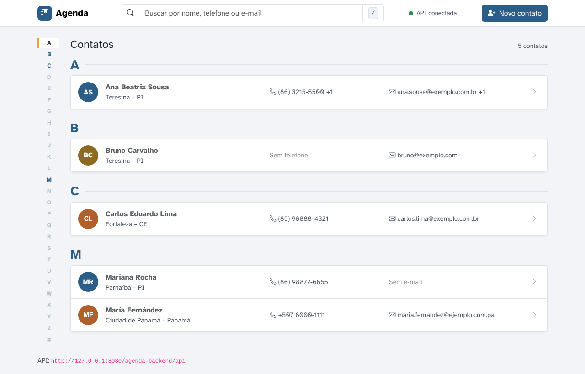

## Sumário

1. [Visão geral](#1-visão-geral)
2. [Stack de tecnologias](#2-stack-de-tecnologias)
3. [Estrutura de arquivos](#3-estrutura-de-arquivos)
4. [Arquitetura e componentes](#4-arquitetura-e-componentes)
5. [Integração com o backend](#5-integração-com-o-backend)
6. [Fluxo de requisição](#6-fluxo-de-requisição)
7. [Interação com cada endpoint da API](#7-interação-com-cada-endpoint-da-api)
8. [Build e implantação](#8-build-e-implantação)
9. [Testes](#9-testes)
10. [Problemas comuns](#10-problemas-comuns)
11. [Licenças das bibliotecas incluídas](#11-licenças-das-bibliotecas-incluídas)

---

## 1. Visão geral

A aplicação é uma página única (`index.html`). Ao abrir, ela busca os contatos na API e os
mostra agrupados por letra, como as folhas de uma agenda de papel, com um índice alfabético
lateral. Todas as operações acontecem na mesma página, por meio de um painel lateral e de
janelas modais, sem recarregar a tela.

| Funcionalidade | Como o usuário aciona | Endpoint chamado |
|---|---|---|
| Listar contatos agrupados por letra | Ao abrir a página | `GET /api/contatos` |
| Pular para uma letra | Clique no índice alfabético | (usa a lista já carregada) |
| Buscar por nome, telefone ou e-mail | Digitar na barra de busca (atalho `/`) | `GET /api/contatos?q=texto` |
| Ver detalhes | Clique num contato | `GET /api/contatos/{id}` |
| Cadastrar | Botão **Novo contato** | `POST /api/contatos` |
| Editar | **Editar** no painel de detalhes | `PUT /api/contatos/{id}` |
| Excluir com confirmação | **Excluir** no painel de detalhes | `DELETE /api/contatos/{id}` |
| Indicador de saúde da API | Automático, a cada 30 s | `GET /api/health` |

Outros recursos:

- **Vários telefones e e-mails por contato**, com botões para adicionar e remover campos.
- **Validação no navegador** com as mesmas regras do `ContatoValidator` do backend. Se a API
  ainda assim recusar os dados, a lista `detalhes` da resposta aparece no formulário.
- **Destaque do termo buscado**, sem diferenciar maiúsculas nem acentos.
- **Copiar** telefone ou e-mail, links `tel:` e `mailto:`, e **Ver no mapa** (OpenStreetMap).
- **Mensagens de erro específicas**: API fora do ar, banco indisponível, contato já excluído.
- **Layout responsivo**: no celular, o índice vira uma faixa horizontal e o formulário ocupa
  a tela inteira.
- **Funciona sem internet**: Bootstrap, ícones e fonte estão dentro do projeto.

| Painel de detalhes | Formulário com validação | Celular |
|---|---|---|
| 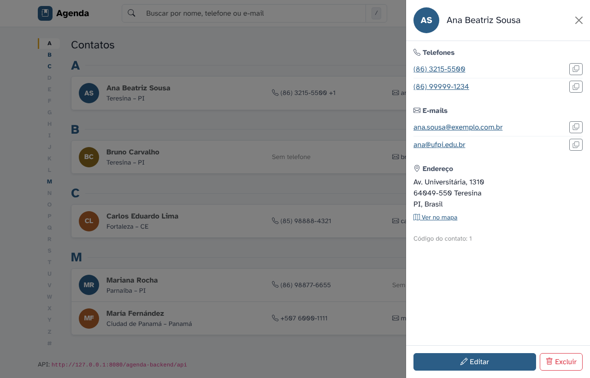 | 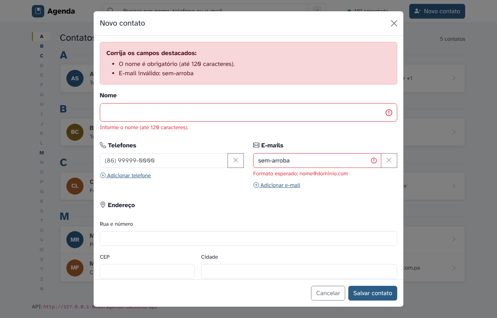 | 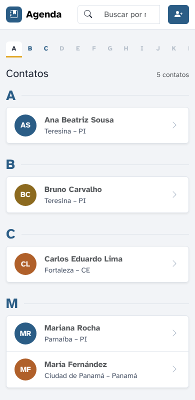 |

---

## 2. Stack de tecnologias

| Camada | Tecnologia | Versão | Uso |
|---|---|---|---|
| Estrutura | HTML5 | - | Página única com navbar, lista, painel lateral e modais |
| Estilo | CSS3 + variáveis CSS | - | Identidade visual sobre o Bootstrap (`css/app.css`) |
| Lógica | JavaScript (ES2017) | - | `fetch`, `async/await`, `Promise`; sem frameworks e sem módulos |
| UI | [Bootstrap](https://getbootstrap.com/) | 5.3.8 | Grid, formulários, modal, offcanvas, toast, tooltip |
| Ícones | [Bootstrap Icons](https://icons.getbootstrap.com/) | 1.13.1 | Ícones como fonte (`bi bi-*`) |
| Fonte | Atkinson Hyperlegible (Fontsource) | 5.3.0 | Fonte com alta legibilidade, em WOFF2 |
| Empacotamento | Apache Maven | 3.3.9 ou superior | Gera o `agenda-frontend.war` |
| Servidor | Apache Tomcat | 8.5 | Serve os arquivos estáticos em `/agenda-frontend` |
| Testes | Playwright + Chromium | - | Teste ponta a ponta automatizado (opcional, seção 9) |

Por que JavaScript puro e scripts comuns (sem `type="module"`)?

- O projeto é didático: cada arquivo pode ser lido de cima para baixo, sem transpilação.
- Scripts comuns funcionam em qualquer servidor estático, sem configuração de tipos MIME para
  módulos.
- Os três scripts trocam informações por dois objetos globais bem definidos:
  `window.AGENDA_CONFIG` e `window.AgendaApi`.

Plugins Maven (os mesmos do backend, compatíveis com Maven 3.3.9):

| Plugin | Versão |
|---|---|
| `maven-war-plugin` | 3.3.2 |
| `maven-resources-plugin` | 3.2.0 |
| `maven-compiler-plugin` | 3.8.1 (sem código Java para compilar) |
| `maven-surefire-plugin` | 2.22.2 (sem testes Java) |
| `maven-clean-plugin` / `maven-install-plugin` | 3.1.0 / 2.5.2 |

---

## 3. Estrutura de arquivos

```
agenda-frontend/
├── pom.xml                          empacotamento WAR (Maven 3.3.9 + JDK 8)
├── README.md                        este documento
├── .gitignore                       ignora target/ e arquivos do Eclipse
├── docs/                            capturas de tela usadas neste README
│   ├── tela-lista.png
│   ├── tela-detalhes.png
│   ├── tela-formulario.png
│   └── tela-celular.png
├── tests/
│   └── teste_e2e.py                 teste ponta a ponta com Playwright (seção 9)
└── src/main/webapp/                 tudo o que é publicado no Tomcat
    ├── index.html                   página única: navbar, índice, lista, painel e modais
    ├── WEB-INF/
    │   └── web.xml                  página inicial e tipo MIME das fontes WOFF2
    ├── css/
    │   └── app.css                  cores, fonte, índice alfabético, linhas de contato
    ├── js/
    │   ├── config.js                URL da API e parâmetros de tempo
    │   ├── api.js                   cliente da API REST (fetch + ApiError)
    │   └── app.js                   lógica da interface
    └── vendor/                      bibliotecas locais (funcionam sem internet)
        ├── bootstrap/               bootstrap.min.css, bootstrap.bundle.min.js (+ .map)
        ├── bootstrap-icons/         bootstrap-icons.min.css e fontes
        └── fonts/                   Atkinson Hyperlegible (400 e 700, latin e latin-ext)
```

| Arquivo | Linhas | Responsabilidade |
|---|---|---|
| `index.html` | 198 | Marcação de toda a interface. Carrega os CSS no `<head>` e os scripts no fim do `<body>`, nesta ordem: Bootstrap, `config.js`, `api.js`, `app.js`. |
| `css/app.css` | 184 | Declara a fonte, sobrescreve variáveis do Bootstrap (`--bs-primary`, `--bs-body-bg`...) e estiliza o índice, os grupos por letra, as linhas, os avatares e os estados vazios. |
| `js/config.js` | 34 | Define `window.AGENDA_CONFIG` com a URL da API e os tempos de verificação e de busca. |
| `js/api.js` | 79 | Define `window.AgendaApi`: uma função por endpoint e a classe de erro `ApiError`. |
| `js/app.js` | 633 | Estado da tela, desenho da lista, índice, busca, painel de detalhes, formulário, exclusão, avisos e indicador de saúde. |
| `WEB-INF/web.xml` | 22 | Define `index.html` como página inicial e o tipo `font/woff2`. |
| `pom.xml` | 67 | Coordenadas `br.ufpi.agenda:agenda-frontend:1.0.0`, packaging `war`, plugins. |

Tamanho das bibliotecas em `vendor/`: Bootstrap 1,3 MB (com os arquivos `.map`), Bootstrap
Icons 412 KB e fontes 76 KB.

---

## 4. Arquitetura e componentes

### 4.1 Onde cada parte roda

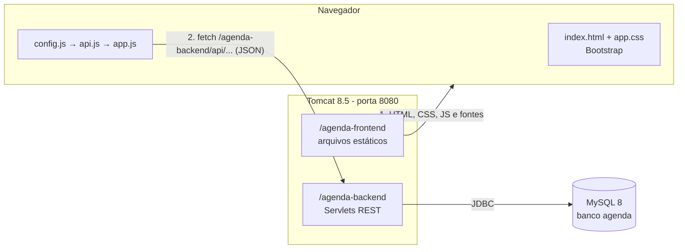

O Tomcat entrega os arquivos do frontend uma vez (passo 1). A partir daí, todo o trabalho
acontece no navegador: o JavaScript chama a API do backend (passo 2) e redesenha a tela com
os dados recebidos. O frontend nunca acessa o banco diretamente.

### 4.2 Os três scripts

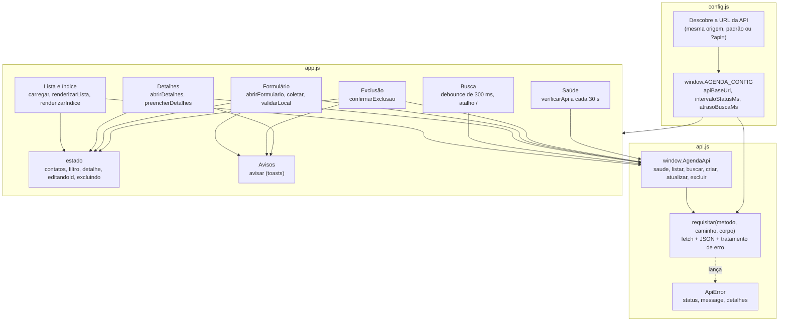

### 4.3 Componentes da interface

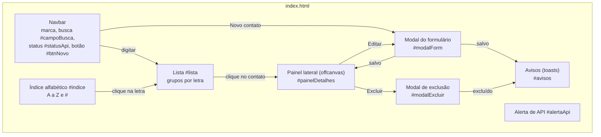

| Componente | Elemento Bootstrap | Função em `app.js` |
|---|---|---|
| Barra de busca | `input-group` | `carregar()` após 300 ms sem digitar |
| Indicador de status | badge com tooltip | `verificarApi()` |
| Índice alfabético | botões próprios (`.indice`) | `renderizarIndice()`, `marcarLetra()` |
| Lista de contatos | `list-group` com `list-group-item-action` | `renderizarLista()`, `linhaContato()` |
| Painel de detalhes | `offcanvas offcanvas-end` | `abrirDetalhes()`, `preencherDetalhes()` |
| Formulário | `modal modal-lg` com `modal-fullscreen-sm-down` | `abrirFormulario()`, evento `submit` |
| Confirmação de exclusão | `modal modal-dialog-centered` | `confirmarExclusao()` |
| Avisos | `toast` | `avisar()` |
| Estado vazio | bloco próprio (`.vazio`) | `estadoVazio()` |

### 4.4 Decisões de implementação

- **Segurança contra injeção de HTML.** Todo dado vindo da API entra na página por
  `textContent` ou `document.createTextNode`, nunca por `innerHTML`. Um nome como
  `<script>alert(1)</script>` aparece como texto e não é executado. A função auxiliar
  `criar(tag, props, filhos)` monta os elementos sem concatenar HTML.
- **Estado em um único objeto.** `estado` guarda a lista carregada, o filtro atual, o contato
  aberto no painel, o id em edição e o contato a excluir. As funções de desenho leem dele.
- **Lista agrupada por letra.** A API já devolve os contatos em ordem alfabética. O
  `app.js` só agrupa pela primeira letra sem acento (`Ágata` vai para **A**); nomes que não
  começam com letra vão para **#**.
- **Avatar com iniciais.** A cor vem de um hash do nome, então o mesmo contato sempre tem a
  mesma cor.
- **Índice que acompanha a rolagem.** Um `IntersectionObserver` marca a letra do grupo que
  está no topo da tela.

---

## 5. Integração com o backend

### 5.1 Qual URL da API é usada

O `config.js` decide a URL uma única vez, quando a página carrega:

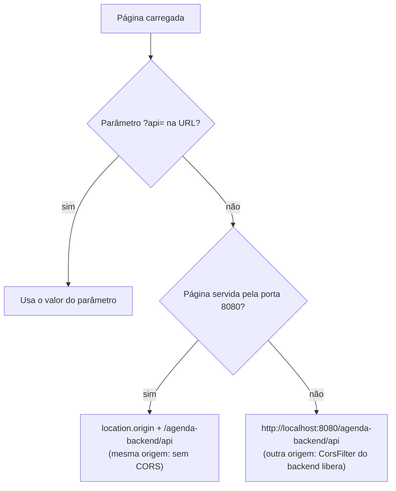

| Como o frontend é aberto | URL da API | CORS envolvido? |
|---|---|---|
| `http://localhost:8080/agenda-frontend/` (mesmo Tomcat) | `http://localhost:8080/agenda-backend/api` | Não, mesma origem |
| `http://localhost:5500/` (Live Server ou `python3 -m http.server`) | `http://localhost:8080/agenda-backend/api` | Sim, liberado pelo `CorsFilter` |
| `...?api=http://servidor:8080/agenda-backend/api` | O valor informado | Depende da origem |

A URL em uso aparece no rodapé da página, o que ajuda a diagnosticar problemas de conexão.

### 5.2 Contrato com o backend

O frontend depende de três acordos com o agenda-backend:

1. **Formato do contato** (entrada e saída):

```json
{
  "id": 1,
  "nome": "Ana Souza",
  "telefones": ["(86) 99999-0000"],
  "emails": ["ana@ufpi.edu.br"],
  "endereco": { "rua": null, "cep": "64049-550", "cidade": "Teresina", "estado": "PI", "pais": "Brasil" }
}
```

2. **Formato de erro**: `{"erro": "mensagem", "status": 400, "detalhes": ["..."]}`.
3. **Regras de validação**: as mesmas do `ContatoValidator`, repetidas em `validarLocal()`.

| Campo | Regra (igual nos dois projetos) |
|---|---|
| `nome` | Obrigatório, até 120 caracteres |
| `telefones[]` | 6 a 30 caracteres entre dígitos, espaço e `+ ( ) - .` |
| `emails[]` | Até 150 caracteres, formato `algo@algo.algo` |
| `endereco.*` | Limitados pelo `maxlength` dos campos: rua 200, CEP 20, cidade 100, estado e país 60 |

A validação no navegador é uma conveniência: evita uma ida ao servidor e destaca o campo
errado. A validação que vale é a do backend, e o frontend mostra os erros que ela devolver.

### 5.3 Cliente da API (`api.js`)

Todas as chamadas passam por uma única função:

```js
async function requisitar(metodo, caminho, corpo) {
    var opcoes = { method: metodo, headers: { "Accept": "application/json" } };
    if (corpo !== undefined) {
        opcoes.headers["Content-Type"] = "application/json; charset=UTF-8";
        opcoes.body = JSON.stringify(corpo);
    }
    var resposta;
    try {
        resposta = await fetch(BASE + caminho, opcoes);
    } catch (e) {
        throw new ApiError(0, "A API não respondeu em " + BASE + ".");   // rede, servidor parado, CORS
    }
    var texto = await resposta.text();
    var dados = texto ? JSON.parse(texto) : null;
    if (!resposta.ok) {
        throw new ApiError(resposta.status, dados && dados.erro, dados && dados.detalhes);
    }
    return dados;
}
```

Assim, o `app.js` só lida com dois resultados: os dados, quando dá certo, ou um `ApiError` com
`status`, `message` e `detalhes`. O caso `status = 0` significa que a API não respondeu.

### 5.4 Como cada status é tratado na tela

| Status | Situação | O que o usuário vê |
|---|---|---|
| 200 / 201 | Sucesso | Lista atualizada e aviso verde (“Contato salvo.”, “Alterações salvas.”, “… foi excluído.”) |
| 400 | Dados recusados pela API | Caixa vermelha no formulário com a lista `detalhes` |
| 404 | Contato não existe mais | Aviso amarelo e lista recarregada |
| 500 | Erro no banco durante uma operação | Mensagem genérica do backend, sem detalhes internos |
| 503 | `/api/health` com banco fora | Indicador “Banco indisponível” |
| 0 | API não respondeu | Indicador vermelho “API indisponível” e alerta com link para `/api/health` e **tente de novo** |

---

## 6. Fluxo de requisição

### 6.1 Carga inicial

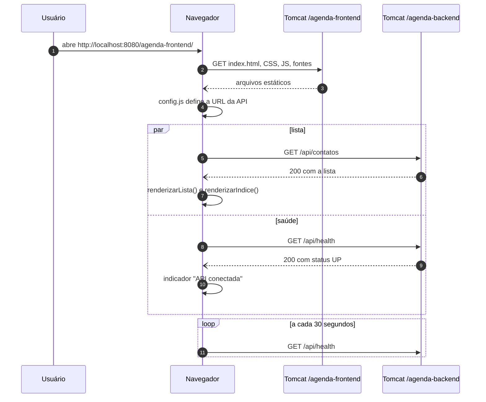

### 6.2 Cadastro de um contato

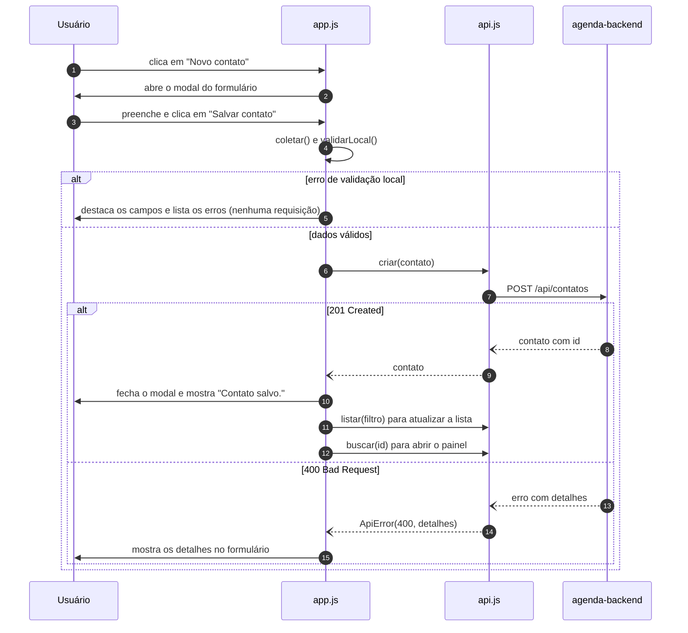

### 6.3 Busca com espera (debounce)

Cada tecla digitada reinicia um temporizador de 300 ms. A requisição só sai quando o usuário
para de digitar, então “maria” gera uma chamada, e não cinco.

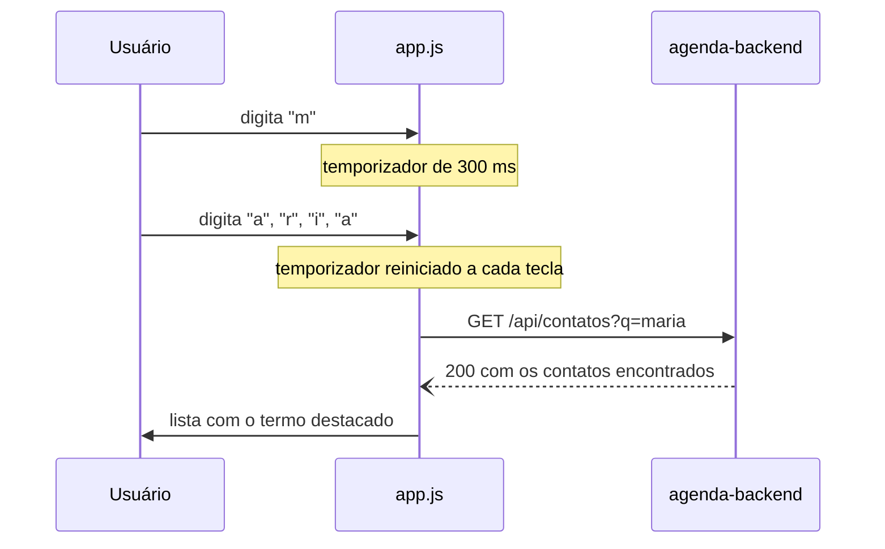

### 6.4 Edição e exclusão

```
Editar:   painel > "Editar" > painel fecha > modal preenchido com o contato
          > "Salvar alterações" > validarLocal() > PUT /api/contatos/{id}
          > 200: aviso, lista recarregada e painel reaberto com os dados novos
          > 404: aviso de que o contato foi excluído e lista recarregada

Excluir:  painel > "Excluir" > painel fecha > modal de confirmação
          > "Excluir contato" > DELETE /api/contatos/{id}
          > 200: aviso "<nome> foi excluído." e lista recarregada
          > 404: aviso "Esse contato já tinha sido excluído." e lista recarregada
```

O painel é fechado antes de abrir um modal para evitar a disputa de foco entre os dois
componentes do Bootstrap.

---

## 7. Interação com cada endpoint da API

Nos exemplos, `BASE` é `http://localhost:8080/agenda-backend/api`. Os comandos `curl`
reproduzem exatamente o que o navegador envia, e servem para testar o backend sem a interface.

### 7.1 `GET /api/health`: indicador de saúde

**Quando é chamado:** ao abrir a página e depois a cada 30 segundos (`intervaloStatusMs`).
**Função:** `AgendaApi.saude()` em `verificarApi()`.

```bash
curl $BASE/health
```

```json
{"java": "1.8.0_514", "servidor": "Apache Tomcat/8.5.100", "banco": "MySQL 8.0.46", "status": "UP"}
```

| Resultado | Indicador | Dica ao passar o mouse |
|---|---|---|
| 200 com `UP` | ponto verde, “API conectada” | versões do MySQL, do Tomcat e do Java |
| 503 com `DOWN` | ponto vermelho, “Banco indisponível” | o motivo informado pelo backend |
| sem resposta | ponto vermelho, “API indisponível” | a URL que não respondeu |

### 7.2 `GET /api/contatos`: lista e busca

**Quando é chamado:** ao abrir a página, depois de cada cadastro, edição ou exclusão, e
300 ms depois que o usuário para de digitar na busca.
**Função:** `AgendaApi.listar(filtro)` em `carregar()`.

```js
AgendaApi.listar("ana");   // GET /api/contatos?q=ana  (o texto é codificado com encodeURIComponent)
AgendaApi.listar("");      // GET /api/contatos
```

```bash
curl "$BASE/contatos?q=ana"
```

O que a tela faz com a resposta:

1. agrupa os contatos pela primeira letra do nome;
2. desenha um `list-group` por letra, com avatar, nome, cidade, primeiro telefone e primeiro
   e-mail (com “+1”, “+2” quando há mais);
3. habilita no índice só as letras que têm contatos;
4. destaca o termo buscado com `<mark>`;
5. mostra a contagem (“3 contatos”) ou um estado vazio com **Limpar busca**.

### 7.3 `GET /api/contatos/{id}`: painel de detalhes

**Quando é chamado:** ao clicar num contato e depois de salvar um cadastro ou uma edição.
**Função:** `AgendaApi.buscar(id)` em `abrirDetalhes(id)`.

```bash
curl $BASE/contatos/1
```

O contato é buscado de novo, mesmo já estando na lista, para que o painel sempre mostre os
dados atuais do banco. O painel exibe telefones (com link `tel:` e botão de copiar), e-mails
(com `mailto:` e copiar), endereço com link para o OpenStreetMap e o código do contato. Um
404 mostra o aviso “Esse contato não existe mais” e recarrega a lista.

### 7.4 `POST /api/contatos`: cadastro

**Quando é chamado:** ao salvar o formulário aberto por **Novo contato**.
**Função:** `AgendaApi.criar(contato)`.

O que `coletar()` monta a partir do formulário: campos de texto vazios viram `null`, e campos
de telefone e e-mail vazios são descartados.

```js
{
  nome: "Diego Lima",
  telefones: ["(86) 91234-5678", "(86) 3222-0000"],
  emails: ["diego@exemplo.com"],
  endereco: { rua: null, cep: null, cidade: "Teresina", estado: "PI", pais: "Brasil" }
}
```

Requisição equivalente:

```bash
curl -i -X POST $BASE/contatos -H "Content-Type: application/json" \
     -d '{"nome":"Diego Lima","telefones":["(86) 91234-5678","(86) 3222-0000"],"emails":["diego@exemplo.com"],"endereco":{"cidade":"Teresina","estado":"PI","pais":"Brasil"}}'
```

| Resposta | O que a tela faz |
|---|---|
| 201 com o contato | Fecha o modal, mostra “Contato salvo.”, recarrega a lista e abre o painel do novo contato |
| 400 com `detalhes` | Mantém o modal aberto e lista os erros devolvidos pela API |
| outro erro | Mantém o modal aberto com “Não foi possível salvar.” e a mensagem |

Novos contatos vêm com o país “Brasil” preenchido, e o campo oferece sugestões por
`<datalist>`.

### 7.5 `PUT /api/contatos/{id}`: edição

**Quando é chamado:** ao salvar o formulário aberto por **Editar**.
**Função:** `AgendaApi.atualizar(id, contato)`.

O `PUT` do backend substitui todos os dados do contato. Por isso o formulário é sempre
preenchido com o contato completo, e o objeto inteiro é enviado de volta. Um telefone removido
com o botão **×** simplesmente não vai na lista e é apagado no banco.

```bash
curl -X PUT $BASE/contatos/4 -H "Content-Type: application/json" \
     -d '{"nome":"Diego Lima","telefones":["(86) 91234-5678"],"emails":["diego@exemplo.com"],"endereco":{"cidade":"Parnaíba","estado":"PI","pais":"Brasil"}}'
```

| Resposta | O que a tela faz |
|---|---|
| 200 com o contato | Fecha o modal, mostra “Alterações salvas.”, recarrega a lista e reabre o painel |
| 400 | Lista os erros no formulário |
| 404 | Fecha o modal, avisa que o contato foi excluído por outra pessoa e recarrega a lista |

### 7.6 `DELETE /api/contatos/{id}`: exclusão

**Quando é chamado:** ao confirmar no modal **Excluir contato?**.
**Função:** `AgendaApi.excluir(id)`.

```bash
curl -X DELETE $BASE/contatos/4
```

```json
{"excluido": 4}
```

| Resposta | O que a tela faz |
|---|---|
| 200 | Aviso “Diego Lima foi excluído.”, fecha painel e modal, recarrega a lista |
| 404 | Aviso “Esse contato já tinha sido excluído.” e recarrega a lista |

### 7.7 Requisições de preflight (CORS)

Quando o frontend é servido por outra origem (por exemplo, a porta 5500), o navegador envia
automaticamente um `OPTIONS` antes de `POST` e `PUT` com JSON e antes de `DELETE`. O
`CorsFilter` do backend responde 204, e só então a requisição real é enviada. No mesmo Tomcat
isso não acontece, porque a origem é a mesma. Nenhum código do frontend trata o preflight: é
o navegador que o faz.

---

## 8. Build e implantação

### 8.1 Pré-requisitos

1. **agenda-backend funcionando**: `http://localhost:8080/agenda-backend/api/health` deve
   responder com `"status": "UP"`.
2. JDK 8 e Maven 3.3.9 (os mesmos do backend), para gerar o WAR.
3. Tomcat 8.5, standalone ou configurado no Eclipse.
4. Um navegador atual: Firefox, Chrome ou Edge.

### 8.2 O que o build faz

Não há compilação nem minificação. O `mvn package` apenas copia `src/main/webapp` para dentro
de um WAR:

```bash
cd agenda-frontend
JAVA_HOME=/usr/lib/jvm/java-8-openjdk-amd64 mvn clean package
```

Resultado: `target/agenda-frontend.war`, com esta estrutura:

```
agenda-frontend.war
├── index.html
├── css/app.css
├── js/config.js, api.js, app.js
├── vendor/...
└── WEB-INF/web.xml
```

### 8.3 Implantação pelo Eclipse (recomendado)

1. *File > Import… > Maven > Existing Maven Projects* e selecione a pasta `agenda-frontend`.
2. Clique com o botão direito no projeto > *Maven > Update Project…* (`Alt+F5`).
3. Na aba *Servers*, botão direito no **Tomcat v8.5** > *Add and Remove…*, mova
   `agenda-frontend` para *Configured*, mantendo o `agenda-backend`.
4. Inicie ou reinicie o servidor.
5. Acesse **http://localhost:8080/agenda-frontend/**.

Como o projeto não tem classes Java, ele não depende do compilador do Eclipse nem de
*Run As > Maven build*. Depois de editar um `.html`, `.css` ou `.js`, o Eclipse republica o
arquivo sozinho; recarregue a página com `Ctrl+Shift+R`.

> **Dica:** se o publish falhar com “File not found … pom.properties”, desmarque
> *Maven Archiver generates files under the build directory* em
> *Window > Preferences > Maven > Java EE Integration* e rode *Maven > Update Project…*.

### 8.4 Implantação no Tomcat standalone

```bash
sudo cp target/agenda-frontend.war /opt/apache-tomcat-8.5.100/webapps/
```

O Tomcat descompacta e publica em `http://localhost:8080/agenda-frontend/`. Faça o mesmo com
o `agenda-backend.war` para ter as duas aplicações no mesmo servidor. Com o Tomcat parado,
inicie com:

```bash
sudo env JAVA_HOME=/usr/lib/jvm/java-8-openjdk-amd64 /opt/apache-tomcat-8.5.100/bin/startup.sh
```

### 8.5 Servidor estático (desenvolvimento rápido, sem WAR)

Com o backend no Tomcat:

```bash
cd agenda-frontend/src/main/webapp
python3 -m http.server 5500
```

Abra `http://localhost:5500/`. A página chama `http://localhost:8080/agenda-backend/api`, e o
`CorsFilter` do backend libera a origem diferente. A extensão **Live Server** do VS Code
funciona da mesma forma.

Não abra o `index.html` com duplo clique (`file://`). Nesse caso, o navegador envia a origem
`null`, o que complica o CORS.

### 8.6 Configuração

| O que mudar | Onde |
|---|---|
| URL da API (fixa) | `js/config.js`, constante `PADRAO` |
| URL da API (temporária) | Abrir a página com `?api=http://host:porta/agenda-backend/api` |
| Intervalo da verificação de saúde | `intervaloStatusMs` em `config.js` (30 000 ms) |
| Espera da busca após digitar | `atrasoBuscaMs` em `config.js` (300 ms) |
| Cores e fonte | Variáveis no início de `css/app.css` |
| Context root no Eclipse | *Properties > Web Project Settings* (padrão `agenda-frontend`) |

---

## 9. Testes

### 9.1 Como foram feitos

O frontend foi testado em três frentes:

| Tipo | Ferramenta | O que cobre |
|---|---|---|
| Ponta a ponta automatizado | Playwright + Chromium sem interface (`tests/teste_e2e.py`) | Fluxo completo: saúde, lista, busca, validação, cadastro, edição, exclusão e layout de celular |
| Tratamento de falhas | Playwright com URL de API inexistente (`?api=`) | Indicador “API indisponível” e alerta com **tente de novo** |
| Manual | Navegador + ferramentas do desenvolvedor (`F12`) | Roteiro de 17 casos (seção 9.4), conferindo as requisições na aba Rede |

Durante o desenvolvimento, os testes automatizados rodaram contra uma API simulada que
reproduz o contrato do agenda-backend: mesmas rotas, mesmo formato de contato e de erro e
mesmas regras de validação. Todos os passos passaram, sem erros de JavaScript no console.
As capturas em `docs/` foram geradas nessa execução. Com o mesmo script, rode agora contra o
backend real (seção 9.3).

O projeto não tem testes Java: não há código Java. Por isso o `mvn package` não executa testes,
e o `maven-surefire-plugin` apenas informa que não há o que rodar.

### 9.2 O teste automatizado (`tests/teste_e2e.py`)

O script abre o navegador, executa cada passo e confere o resultado na tela:

| # | Passo | Endpoint exercitado | Verificação |
|---|---|---|---|
| 1 | Abrir a página | `GET /api/health` | Indicador mostra “API conectada” |
| 2 | Aguardar a lista | `GET /api/contatos` | Há linhas de contato; guarda o total |
| 3 | Buscar texto inexistente | `GET /api/contatos?q=` | Estado vazio visível; ao limpar, volta o total |
| 4 | Salvar com nome vazio e e-mail `sem-arroba` | nenhum | Erros listados no formulário |
| 5 | Cadastrar com dois telefones | `POST` e `GET /{id}` | Painel abre com o nome e o 2º telefone; total + 1 |
| 6 | Editar a cidade para “Parnaíba” | `PUT` e `GET /{id}` | Painel mostra a nova cidade |
| 7 | Excluir com confirmação | `DELETE` | Total volta ao valor inicial |
| 8 | Abrir em 390 px de largura | `GET /api/contatos` | Coluna de telefone oculta |

O contato criado no passo 5 é excluído no passo 7, então o banco termina como começou.

Saída esperada:

```
  [OK] indicador mostra 'API conectada' (GET /api/health)
  [OK] lista carregada com 3 contatos (GET /api/contatos)
  [OK] busca sem resultado mostra o estado vazio (GET /api/contatos?q=)
  [OK] validação local bloqueia nome vazio e e-mail inválido (nenhuma requisição)
  [OK] cadastro com dois telefones (POST /api/contatos -> 201)
  [OK] edição da cidade (PUT /api/contatos/{id} -> 200)
  [OK] exclusão com confirmação (DELETE /api/contatos/{id} -> 200)
  [OK] layout de celular oculta a coluna de telefone
Todos os testes passaram.
```

Qualquer falha interrompe o script com a linha e o motivo. Erros de JavaScript capturados
durante o teste fazem o script terminar com código 1.

### 9.3 Como executar o teste automatizado

Uma única vez, instale o Playwright e o Chromium:

```bash
pip install playwright           # no Ubuntu 24.04: pip install --user --break-system-packages playwright
python3 -m playwright install chromium
python3 -m playwright install-deps chromium   # bibliotecas do sistema, se pedir
```

Com o backend e o frontend publicados no Tomcat:

```bash
cd agenda-frontend
python3 tests/teste_e2e.py
```

Para testar outro endereço, passe a URL como argumento:

```bash
python3 tests/teste_e2e.py http://127.0.0.1:8080/agenda-frontend/
```

### 9.4 Roteiro de testes manuais

Abra a página, pressione `F12` e deixe a aba **Rede** (Network) aberta, filtrando por `api`.

| # | Teste | Passos | Resultado esperado |
|---|---|---|---|
| 1 | Carga inicial | Abrir a página | `GET /api/contatos` 200; contatos agrupados por letra; contagem acima da lista |
| 2 | Saúde da API | Passar o mouse sobre “API conectada” | Versões do MySQL, Tomcat e Java |
| 3 | Índice | Clicar numa letra ativa | A lista rola até o grupo; letras sem contatos desabilitadas |
| 4 | Busca por nome | Digitar `ana` | Uma única chamada `GET /api/contatos?q=ana`; termo destacado |
| 5 | Busca por telefone | Digitar `3215` | Aparece o contato com esse telefone |
| 6 | Busca sem resultado | Digitar `zzz` | Mensagem de nenhum contato e botão **Limpar busca** |
| 7 | Detalhes | Clicar num contato | `GET /api/contatos/{id}`; painel com telefones, e-mails e endereço |
| 8 | Validação local | Novo contato com nome vazio e e-mail `sem-arroba` | Nenhuma requisição; campos em vermelho e lista de erros |
| 9 | Cadastro | Nome, 2 telefones e 1 e-mail, **Salvar contato** | `POST` 201; aviso “Contato salvo.”; painel abre |
| 10 | Edição | **Editar**, mudar a cidade, **Salvar alterações** | `PUT` 200; aviso “Alterações salvas.”; painel atualizado |
| 11 | Remover campo | Na edição, remover um telefone com **×** e salvar | O telefone some dos detalhes |
| 12 | Exclusão | **Excluir** e confirmar | `DELETE` 200; aviso de exclusão; contato sai da lista |
| 13 | Excluído em outra aba | Abrir o mesmo contato em duas abas, excluir numa e salvar edição na outra | Aviso de contato excluído (404 tratado) |
| 14 | Acentos | Cadastrar `João Ávila`, cidade `São Luís` | Acentos preservados; contato no grupo **J** |
| 15 | API fora do ar | Servir pela seção 8.5, parar o Tomcat e recarregar | “API indisponível” e alerta com **tente de novo** |
| 16 | Banco fora do ar | `sudo systemctl stop mysql` e recarregar | “Banco indisponível”; alerta de erro na lista. Volte com `sudo systemctl start mysql` |
| 17 | Celular | `F12` > modo dispositivo, 390 px | Índice horizontal; colunas de telefone e e-mail ocultas; formulário em tela cheia |
| 18 | Injeção de HTML | Cadastrar o nome `<b>teste</b>` | O texto aparece literalmente, sem negrito |

Para conferir no banco:

```bash
mysql -u agenda -pagenda agenda -e "SELECT id, nome, cidade FROM contato ORDER BY nome;"
```

---

## 10. Problemas comuns

| Sintoma | Causa provável e solução |
|---|---|
| “API indisponível” com a página aberta pelo Tomcat | O `agenda-backend` não está publicado ou falhou ao iniciar. Veja o console do Tomcat e teste `/agenda-backend/api/health`. |
| “Banco indisponível” | O backend respondeu, mas o MySQL não. `sudo systemctl start mysql` e confira o `db.properties` do backend. |
| 404 em `/agenda-frontend/` | Projeto não adicionado ao servidor (*Add and Remove…*) ou context root diferente. |
| Página sem estilo e sem ícones | `vendor/` não foi publicado. *Servers > Clean…* e reinicie. |
| Erro de CORS no console | A página está em outra origem e a URL da API não corresponde ao backend. Confira a URL no rodapé e o `allowedOrigins` no `web.xml` do backend. |
| Mudanças no JS ou CSS não aparecem | Cache do navegador: `Ctrl+Shift+R`. |
| “File not found … pom.properties” ao publicar | Veja a dica da seção 8.3. |
| `teste_e2e.py` falha no passo 1 | O backend não está no ar ou a URL passada está errada. Teste `/agenda-backend/api/health` no navegador. |

---

## 11. Licenças das bibliotecas incluídas

- Bootstrap 5.3.8: MIT (`vendor/bootstrap/LICENSE`)
- Bootstrap Icons 1.13.1: MIT (`vendor/bootstrap-icons/LICENSE`)
- Atkinson Hyperlegible: SIL Open Font License 1.1 (`vendor/fonts/LICENSE-atkinson-hyperlegible`)
